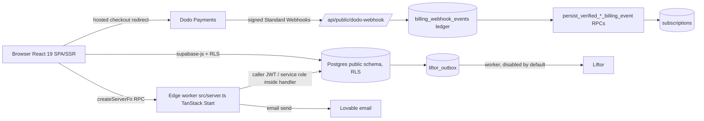
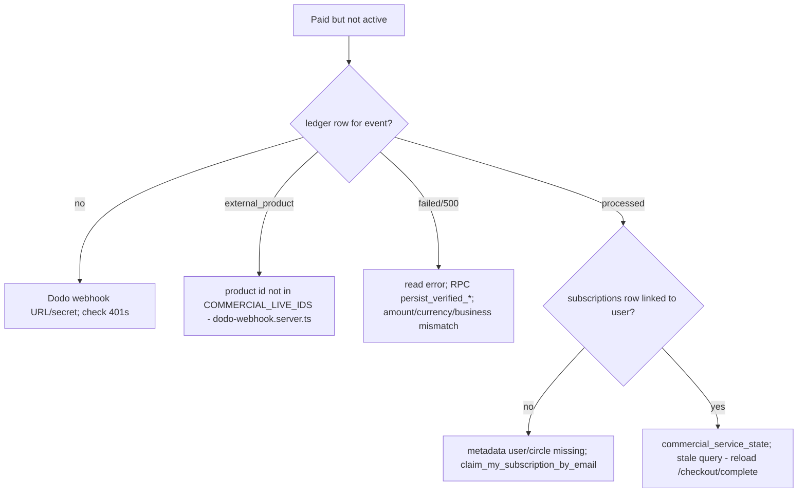

<!-- Copied read-only from the Kindness Habits project (commit a4af3a7b) on 18 Nov 2026. Re-copy to refresh. Previous snapshot: 004630bd (17 Nov 2026). -->

=============== founder/00-COMPLETE_WEBSITE_HANDBOOK.md ===============
# Kindnesss — Complete Website, Sales & Operations Handbook

Updated 18 November 2026. **Private: founder and authorised internal use only.** Download this and its companion manuals from **My account → Admin → Manuals**. This handbook explains the business and the website in plain English; the technical chapters explain how it works underneath.

## How to use the complete manual set

Start here for the offer, audiences, marketing, customer journeys and daily operation. Use the page-by-page register for every website destination, the commercial reference for every published tariff and inclusion, the Help compendium for every current answer, and the technical reference for the software and data map.

1. **This handbook** — business, sales, marketing, customer experience and operations.
2. [Every page and destination](01-WEBSITE_PAGE_REGISTER.md) — public pages, customer pages, payment pages, owner pages, secure links, redirects and service endpoints.
3. [All tariffs and inclusions](02-SALES_TARIFF_REFERENCE.md) — all 51 canonical plans and 45 Head Office aliases, generated from the existing catalogue; not new products.
4. [All current Help Centre answers](03-CUSTOMER_HELP_COMPENDIUM.md) — the actual customer guidance, with steps and destinations.
5. [Your daily operating manual](FOUNDER_OPERATING_MANUAL_2026-11-17.md).
6. [Current whole-system reference](../technical/13-whole-system-reference.md) — source, data, services and technical handover.
7. [Technical chapter index](../technical/README.md) and [customer/support index](../guides/README.md) — detailed specialist guidance.

**Reading priority:** this handbook and the 18 November reference take precedence over older dated manuals for navigation, Help, contact, languages and the current sales journey. Historical reports remain evidence of their own date, not a statement of today's configuration. A manual is not an independent certification or proof that every customer action has been retested live.

## 1. The business and sales proposition

**Kindnesss (three s's)** is a universal, person-centred Kindness Passport and participation platform. The long-term message is **One Kindness Passport. A lifetime of kindness. For everyone.** Ordinary people and self-directed kindness are central: **Your kindness, your way. Everyday kindness counts.** No organisation membership is needed for kindness to be meaningful.

The practical offer is a private place to create kindness missions, record completed acts, reflect, approve where appropriate, build Passport history and recognise progress with badges and non-monetary Kindness Credits. Schools and organisations organise voluntary participation; Head Offices see authorised combined participation totals.

Kindnesss is a commercial product of **Global Solutions Management LLC**, a Delaware limited liability company, State File No. **10420698**. Primary website: **https://joinkindnesss.com**. The footer uses company details and a **Contact us** button; the registered agent's address is not a substitute for the owner's postal address.

### What a buyer is paying for

A subscription pays for the selected account or organisational scope and its included features and participant capacity. It does not purchase kindness, credits, donations, influence over another person's Passport, or a reward-transfer service. Monthly, quarterly and annual billing change renewal and price, not the feature set within the same capacity tier. Prices are displayed on **/pricing**, not repeated across marketing pages; the internal tariff appendix is a reference only.

Normal sales are **fixed self-service**: select a published plan, create/sign in to the relevant account, accept standard electronic terms and the applicable organisation agreement, pay through Dodo, then finish setup. Do not introduce a sales call, quote, manual signature or human approval into ordinary published-plan onboarding. Specialist safeguarding enquiries and future partnerships are different from ordinary subscription purchases.

## 2. Audiences, buyers and the right destination

Keep four roles separate: **participant/Passport holder**, **trusted supporter or verifier**, **organiser**, and **purchaser/funder**. Paying does not grant access to someone's private records or make someone a guardian.

| Audience | The relevant proposition | Starting page | Working area |
|---|---|---|---|
| Independent adult | Private self-directed kindness missions, reflections and personal progress; acts are self-recorded | /kindness-passport, /families, /pricing | /family in personal Passport mode |
| Family and guardian | Invited trusted adults, guardian-reviewed children's reflections, private Passport history | /families, /pricing | /family, /review, /settings |
| School | Staff and teachers, years/forms, candidates, dated campaigns, participation reporting | /schools, /pricing | /organisation; /school redirects to it |
| Education Group Head Office | Hierarchy, schools and pooled participant licensing with privacy-protected aggregate reporting | /school-groups, /pricing | /hq and the authorised Education Group Console |
| Organisation or workplace | Voluntary missions, teams/participants, approval and aggregate participation reporting | /organisations, /companies, /pricing | /organisation |
| Organisation Head Office | Multiple locations under pooled participant capacity, combined reports and local site responsibilities | /organisation-hq, /pricing | /hq, /company-groups |
| Charity/community organiser | Ordinary Organisation tariff and voluntary participation, with the genuine sector retained | /charities, /organisations | Relevant Organisation Console |
| Care, supported living, disability or public service | Accessible participation and dignity; specialist participant safeguards need their own suitability design | /care, /accessibility, /public-services | Only the approved account scope, never an implied specialist beneficiary module |
| Sponsor/partner | Explore a partnership separately from buying a normal plan | /partners, /contact | Sponsored invitations/payment activation are not an open customer sales journey |

The universal positioning does not imply that every specialist module, accreditation, integration or partnership exists. **Pathways is retired as a customer product**: historical records are preserved, old customer entries redirect, and new activation stays closed. Friends/Community legacy destinations are not an invitation to open an unpaid product.

## 3. Marketing proposition and page strategy

### Homepage

The homepage introduces the universal brand, everyday kindness, audiences, dashboard-style previews and trust information. It is an invitation to explore or choose a plan, not a promise of guaranteed social outcomes. Preview people and activity are illustrative, not customers, testimonials or live account records. Do not reuse preview totals as sales evidence.

### Passport, process and Circles

**Passport** describes private history and progress. **How it works** explains the action/reflection/approval sequence. **Circles** explains relevant settings without granting access. **Kindness Ideas** offers inspiration: examples are possibilities, never a compulsory menu, score threshold or monetary valuation of an act.

### Sector pages

Explain why the service is relevant to the audience, who participates, who organises and who pays. Use the contextual **Pricing** destination for published plans and **Contact us** for questions or specialist/partnership enquiries. Do not invent sector customers, testimonials, integrations or outcomes. Schools must retain guardian/age safeguards; employers must retain voluntary participation and privacy, not workforce surveillance.

### Experience Kindnesss

The /demo walkthroughs are local-only illustrations of Individual, Family, School, Organisation and group views. They do not sign anyone in, charge, save production records or grant roles. Family is a guided layout without invented console tabs. Explain the appropriate real dashboard rather than claiming every simulation button is a production feature.

### Reporting guide and 20% Impact Promise

Reports show **recorded participation**, not an audited measure of social impact. Suppressed cohorts cannot be reconstructed from exports or drilldowns. Never sell ranking, social scoring or a monetary valuation of kindness.

The Impact Promise is **20% of paid subscription fees actually received, excluding taxes, refunds and chargebacks**, for charitable causes. Kindnesss is not a charity; subscriptions are not donations. Publish recipients and allocations only after they actually occur. A featured initiative is not automatically a funded beneficiary, signed partner or endorsement.

### Navigation, footer and discovery

The shared front-end/customer header uses Passport, Who It's For, Experience Kindnesss, How it works, Pricing and 20% Impact Promise, with audience/sector destinations in its menus and My account for authorised dashboard links. Help Centre and Contact us belong in the footer; the floating **Help** button goes directly to **/help**, not a pop-up. Privacy requests are inside Contact us, not a separate homepage box.

Google Search Console ownership verification is configured in the website head; preserve the verification tag and sitemap. SEO metadata describes each page; an indexed page is not proof of a sale or usage. Do not index secure invitations or private customer/admin pages.

## 4. Complete purchase and account journey

1. The customer visits **/pricing** and selects the audience, capacity and billing period. Use the internal tariff reference to answer inclusion questions; never invent a price or product ID.
2. The buyer signs in or creates the relevant account and accepts the applicable current electronic agreements. Email confirmation and agreement acceptance are distinct from payment.
3. The server chooses the authoritative product, USD amount and billing metadata; the browser cannot set a price or grant itself access.
4. Dodo takes the subscription payment. Kindnesss does not handle pledge/reward money.
5. **/checkout/complete** waits for the signed, verified payment record. A return link, pending payment, retry or account creation does not activate a plan. Do not tell a pending customer to buy again without checking the first payment.
6. Family/Individual buyers open their own account. School/Organisation buyers finish the relevant setup. Head Office buyers complete **Finish setting up your Head Office**, provide the name/country and press **Create my Head Office**.
7. The Head Office form is also shown for an active paid but unused HQ subscription when the buyer already has another HQ membership. The server rechecks the subscription before creation; prefilled URL fields do not grant anything.
8. Administrators invite the right adults and add participating people within the subscribed capacity. Invitation acceptance gives only the recorded permitted role.
9. Cancellation, refund and terminal payment events follow the stored lifecycle rules. Use Dodo for billing changes; verify the resulting account state rather than granting access from an email or redirect.

No free customer plans or trials are offered. Unpaid operational access is paused; historical records are not silently deleted. The persistent **owner-only test pass** is a separate non-commercial exception, limited to the owner's own Circles, and stays until the owner requests removal.

## 5. Individual and Family operation

### Individual Plus

The adult uses their own private Passport, creates their own missions, records acts and reflections, approves their own completed acts and builds credits/badges/history. These acts are labelled self-recorded, not independently verified. The plan does not let an adult assign missions to other subscribers or see another person's Passport.

### Family golden path

1. Guardian creates the Family Circle and first-name/nickname child profile.
2. Guardian invites trusted family adults through the private invitation flow.
3. Trusted adult creates a pledge/mission: act, deadline, credits and optional reward details/encouragement.
4. The child completes the act and submits a reflection through their controlled experience. Photo evidence is optional and parent-controlled; do not promise unrestricted uploads.
5. The guardian approves or requests more detail.
6. Approval awards credits **exactly once**, updates the timeline and badge progress. Invited relatives can offer pledges but cannot change safety settings or act as the guardian merely because they paid.
7. Any reward is fulfilled privately, off-platform, by the adult who offered it. Credits cannot be purchased, sold, redeemed, transferred or converted to money.

Family Circle membership is invitation/approval based. Never expose surnames, precise location, school details, contact details or public child profiles by default. There is no stranger-to-child messaging or public child kindness leaderboard.

## 6. School operation

**School Console** uses the existing /organisation account area. The administrator's workflow follows **Overview → Staff → Years & forms → Candidates → Campaigns → Impact → Activity → Billing → Settings**, with visible sections restricted by role.

- **Overview:** setup status and permitted school totals.
- **Staff:** invite/assign adults, school-only teacher tiers and live grants; Headteacher is a designation, not a shared cross-sector role.
- **Years & forms:** maintain the school's structure and form-level teacher assignments.
- **Candidates:** add/import and assign candidates within paid capacity and authorised scope. A subgroup must match its candidate's primary class; changing that class fails while incompatible subgroup assignments remain.
- **My class:** scoped teacher view, not school-wide access. Unverified/erroring role checks fail closed; a reporting viewer gets aggregates rather than identities.
- **Campaigns:** dates, targets and class/form progress; completed acts still follow authorised review rules.
- **Impact/Activity:** authorised participation reports, approvals and activity, not public child comparisons.
- **Billing/Settings:** subscription and permitted school settings; the owner test pass is not a sellable plan.

Portable school links use guardian-controlled stable Passport identities and one-use, hashed links with a 72-hour expiry. They require the appropriate verified guardian, recent sign-in, terms and link disclosure; they do not expose other-school or Family history. Teen verification remains a separate gate. School integrations are reviewed OneRoster CSV interchange, explicit and insert-only, not a promised live synchronisation service.

## 7. Organisation, teams and volunteering

Administrators follow the setup checklist: organisation details, adults/roles, teams and participants, missions, then approvals and reporting. The console orders the relevant sections as Overview, administrators, teams, people, departments (where enabled), missions, volunteering (where enabled), impact, activity, billing and settings. Exact labels depend on the actual circle type and role; do not apply School terminology to an Organisation.

An invited participant accepts the secure link using the intended account, sees the joined confirmation, records an authorised act/reflection, and the appropriate adult/coordinator approves it. Recording alone does not impersonate approval. Team coordinators and reporting viewers do not gain organisation-wide access from a tab or a known record identifier.

Where enabled for a paid company site, volunteering covers opportunities, shifts, bookings, check-in, time and feedback. Participants see their own permitted records, not peers' private information. Check-in codes and feedback remain restricted. Group volunteering totals are shown only when every live site in the selected scope meets the privacy threshold, preventing subtraction from exposing small sites. Do not present volunteer totals as employee performance scoring.

## 8. Head Office operation and licensing

One Company/Organisation HQ uses aliases of the **21 Organisation products**; one Education Group HQ uses aliases of the **24 Education products**. The same existing product may licence a single site or an HQ according to the signed checkout scope. These aliases are not 45 extra Dodo products and do not justify double charging.

Capacity is the pooled number of distinct opted-in participating people across all locations. Non-joiners do not count; opt-out/deletion releases capacity. There is **no paid site/school limit**; the technical ceiling is 5,000 active hierarchy levels per HQ. Independently licensed schools do not have to migrate.

Education hierarchy follows the permitted country/group/school/year/form structure. Organisation hierarchy uses the applicable country/region/site/team presentation. Central users see scope-authorised aggregates and permitted adult administration, **not candidate identities, private reflections, Family records or another school's history**. Cohorts under five are suppressed. A hierarchy link never grants local School Console or employee-detail access. Site staff keep their independent responsibilities.

## 9. Help, Contact us and privacy requests

**Help Centre (/help):** filter by audience and common task, search the existing guides and open the relevant answer. The complete Help compendium reproduces all current published guide steps, so support staff can answer consistently. Archived products are not advertised through current search.

**Contact us (/contact):** short enquiry form with clear essentials: name, email, country and message. Personal enquiries are the default; organisation context does not create an account or grant a plan. A successful submission is saved to the enquiry queue, not sent as a customer-to-owner email thread.

**Admin → Enquiries:** read messages and manage new → contacted → qualified → closed. Reply through your authorised communication process; there is no implied in-app reply/email send button simply because a status changes.

**Contact us → Privacy & data:** use the existing protected request form for access, correction, deletion or other privacy needs. Legacy /privacy-request links lead here. **Admin → Privacy requests** is the owner triage area. Confirm identity before fulfilment, follow the applicable legal deadline and record the action; never assume a blanket deadline applies to every country/request.

New-message alerts go to **mandyking308@gmail.com**. Alerts contain a notification and sign-in destination, not the submitted text or children's details. Check spam and the queues themselves; an email alert is not a delivery or response-time guarantee. Alert deduplication and recent-record checks are described in the technical reference.

## 10. Languages, accessibility, privacy and legal documents

- GTranslate provides **103 languages** when the user opts in. Public pages need cookie translation consent; signed-in pages need separate per-account/session consent. Checkout, auth/recovery, invitations, guardian/child links, volunteering codes and API endpoints are excluded from the external script.
- Local interface labels and browser language/display preferences are separate from external translation. Translation does not convert the server's USD checkout or expand country eligibility. Arabic/right-to-left layout must remain usable; never claim a formal accessibility certification based on automated checks alone.
- Cookies/preferences must respect the user's actual choices; consent to public translation is not consent to translating private account pages. Do not put passwords, card details, secure links or children's private information into ordinary help/contact messages.
- Legal pages include terms, business terms, privacy, children's privacy, cookies, safety, acceptable use, accessibility, billing/refunds, data processing, institutional DPA and security/assurance. Use their canonical pages and current versions, not historical drafts.
- The institutional DPA current update is **institutional-dpa-2026-11-17**. Changing versioned operative wording requires a new version/hash and the corresponding acceptance path. A checkbox is not proof of an unsigned agreement being executed. Do not edit legal promises through a marketing/manual change.
- Do not claim certifications, insurance, independently audited social outcomes, endorsements or jurisdiction coverage without the corresponding evidence. Internal readiness registers are not an attestation.

## 11. Founder administration and daily operation

Sign in to **/admin** using your owner account and required two-step sign-in. Available areas include overview, customers, subscriptions, organisations, seat usage, exceptions, activity/billing, enquiries, privacy requests, legal launch, pricing model, company enterprise, operator staff and **Manuals**. Permissions can hide areas for other operators.

**Daily:** check new alerts and both message queues; review new customer subscriptions, incomplete onboarding and capacity warnings; record issues with page, account role, time and non-sensitive screenshots.

**Weekly:** review unresolved exceptions, privacy deadlines, paid-to-setup problems, alert delivery and suspicious activity; check public links and the main phone journeys after changes. Keep the manuals aligned with releases.

**Billing problems:** match Dodo's payment with the stored subscription/event record. Do not force another payment, invent an entitlement or alter a product. **Access problems:** confirm the signed plan and actual role/scope before changing anything. **Privacy/security incident:** restrict exposure, preserve necessary evidence without exporting private records, use the incident runbook and seek the required legal/security decision.

**Manuals:** download individual files or **Download all (one file)**. These are private owner-only files, not public Help downloads. Keep exported copies securely and note their date; historical manuals in the bundle are labelled references and do not override this current handbook.

## 12. Behind the scenes — explained without code

The front end is everything visitors/customers can see and click: pages, forms, menus, dashboards, language/cookie choices, previews and downloads. The backend validates identity, roles, plan state and data access; stores accounts, circles, missions, completions and legal records; and processes signed payment confirmations. Hiding a button alone is not security.

Dodo handles subscription checkout and billing confirmations. Lovable Cloud holds the application's controlled data/authentication. The email service sends account mail and content-free owner alerts. GTranslate is optional translation, not a permission service. Search Console supports search visibility. Liftor receives only the authorised integration output; its summary feed is read-only totals/dates behind a private key, not a public report or a child-data export.

The detailed source/data/service inventories are in the technical reference. No secret values, passwords, tokens, personal customer data or actual child records belong in any manual.

## 13. Sales answers and claims to avoid

| Customer asks | Accurate answer |
|---|---|
| Can I use it without an organisation? | Independent adult kindness is central; choose Individual Plus for your own private Passport. |
| What does my plan include? | Use /pricing and the exact inclusion/capacity row in the internal tariff reference. |
| Can I try a free account? | The customer offer is paid plans, not a free tier or trial. |
| Are credits money or donations? | No. Credits are non-monetary encouragement; optional adult rewards are off-platform. |
| Is the report independently audited impact? | No. It shows recorded participation with appropriate privacy controls. |
| Does HQ let me read children's/employee details? | No. Central reporting is aggregate and scope-limited; local roles stay separate. |
| Are the demo people customers? | No. Demonstrations are illustrative local examples. |
| Does my subscription fund the featured trust? | Not automatically. The qualified 20% commitment is separate; recipients/allocations are published only after actual allocation. |
| Is every specialist service available? | Ordinary published plans are the sales offer; specialist safeguarding/partnership needs must be considered in their own right. |
| Where do I ask for help or my data? | /help for guides; /contact for enquiries and the Privacy & data tab. |

## 14. Coverage and maintenance

The accompanying registers cover every declared route, every current Help article, every canonical tariff and HQ alias, every source-module path and migration-source path. They are generated from saved source without reading production customer data. They are inventories plus explanations, not a claim that a static parser can understand every database policy or that every vendor setting was reverified today.

For a new page, feature or commercial/legal change: update the relevant plain-language chapter, regenerate the coverage registers, update the technical chapter, run coverage/consistency checks, then follow the save/test/publish/live-verify workflow. Do not treat the older dates in historical evidence as a current release blocker or as proof of current success. The owner states the website is live for selling; today's manual work does not change plans, payments, access or safeguards.

=============== founder/01-WEBSITE_PAGE_REGISTER.md ===============
# Kindnesss — Every Page & Destination

Private owner reference, generated 18 November 2026 from saved source. **91 declared destinations/layouts**, including every content page, secure account/token path, legacy redirect and service endpoint. Dynamic $token/$id/$code values below are route patterns, not usable private links. Pathless layouts are not separate public URLs. Purpose/access descriptions explain intended source behaviour, not a fresh live test.

| Destination | Audience/access | Purpose and customer action | Source |
|---|---|---|---|
| /$ | Unknown URL | Catch-all/not-found handling; no customer data or entitlement is created by an unknown path. | src/routes/$.tsx |
| /__root | Shared application shell | Root document, providers, shared head, error handling and Outlet; not a separate public page. | src/routes/__root.tsx |
| /company-groups | Authorised Company Group staff | Company Group aggregate console and read-only country/region/site drilldown, without employee identities or local team grants. | src/routes/_authenticated.company-groups.tsx |
| /hq | Paid HQ buyer/member | Create a paid unused HQ, finish name/country setup, then manage permitted hierarchy, capacity, invites and combined reports; signed subscription rechecked before creation. | src/routes/_authenticated.hq.tsx |
| /hq/accept | Invited HQ adult | Private Head Office invitation acceptance, limited to the recorded scope and role. | src/routes/_authenticated.hq_.accept.tsx |
| /sponsorships | Existing signed-in sponsorship context | Retained private sponsored summaries; no new sponsored payment activation implied. | src/routes/_authenticated.sponsorships.tsx |
| /_authenticated | Protected shared layout | Client-only pathless auth gate and Outlet for protected descendants; endpoints still validate bearer identity and role. | src/routes/_authenticated.tsx |
| /volunteer | Authorised adult participant | Permitted company volunteering opportunities, shifts, own bookings/check-in/time/feedback; paid site and participant scope enforced. | src/routes/_authenticated.volunteer.tsx |
| /accept-terms | Account holders | Current electronic terms acceptance before permitted account actions; acceptance alone does not grant a subscription. | src/routes/accept-terms.tsx |
| /acceptable-use | Customers | Acceptable-use rules, prohibited conduct and responsible participation. | src/routes/acceptable-use.tsx |
| /accessibility | Everyone | Accessible and supported participation, assistance and relevant account choices; not an independent accessibility certification. | src/routes/accessibility.tsx |
| /admin/ideas | Authorised moderator | Review/moderate community idea suggestions; unreviewed content never automatically reaches the public library. | src/routes/admin.ideas.tsx |
| /admin | Owner/authorised operator | AAL2/role-protected founder console: customers, subscriptions, organisations, capacities, exceptions, billing activity, enquiries, privacy, legal, pricing, operators and owner-only Manuals. | src/routes/admin.index.tsx |
| /admin/pathways | Authorised historical operator | Retained AAL2-protected Pathways history; not a new customer product or activation mechanism. | src/routes/admin.pathways.tsx |
| /api/public/dodo-webhook | Dodo service | Externally callable signed webhook handler; verifies provider signature then records billing atomically; no redirect-based access grant. | src/routes/api/public/dodo-webhook.ts |
| /api/public/liftor-outbox | Authorised integration worker | Existing protected outbox delivery service; its own caller validation and acknowledgement rules, separate from the read-only summary feed. | src/routes/api/public/liftor-outbox.ts |
| /api/public/liftor-privacy-outbox | Authorised privacy worker | Existing protected privacy outbox handler; restricted metadata handoff, never an open request/child-data export. | src/routes/api/public/liftor-privacy-outbox.ts |
| /api/public/liftor-summary-feed | Authorised Liftor service | Private GET key-protected read-only totals/dates feed; 401/403 without the exact key, no browser CORS, no personal names/emails/child records. | src/routes/api/public/liftor-summary-feed.ts |
| /auth | Account holders/buyers | Account sign-in/creation and recovery entry; preserve the intended safe destination and do not infer paid access from sign-in. | src/routes/auth.tsx |
| /billing-refunds | Buyers | Billing, renewals, cancellation and refund policy; provider action and signed stored lifecycle determine service state. | src/routes/billing-refunds.tsx |
| /care | Care/support buyers | Care and supported-participation relevance, dignity and consent boundaries; specialist use is not automatically activated by buying a staff plan. | src/routes/care.tsx |
| /charities | Charity/community buyers | Charity/community relevance using the ordinary Organisation tariff, not a separate charity price or a promised funding partnership. | src/routes/charities.tsx |
| /checkout/company-plus | Legacy checkout entry | Compatibility Company Plus destination; do not substitute legacy contracts/products for current published tariffs. | src/routes/checkout.company-plus.tsx |
| /checkout/company-starter | Legacy checkout entry | Compatibility Company Starter destination; current selection belongs on /pricing. | src/routes/checkout.company-starter.tsx |
| /checkout/complete | Returning buyer | Session-bound existing activation polling; wait for the signed verified subscription and continue to the correct setup/dashboard without forcing repayment. | src/routes/checkout.complete.tsx |
| /checkout/kindnesss-company | Legacy Company buyer | Retained Company checkout entry under its existing server gates; not the authoritative new 51-plan price source. | src/routes/checkout.kindnesss-company.tsx |
| /checkout/kindnesss-plus | Legacy Family buyer | Retained Family checkout entry; current buyers choose their published tariff via /pricing and /checkout/plan. | src/routes/checkout.kindnesss-plus.tsx |
| /checkout/kindnesss-school | Legacy School buyer | Retained School checkout entry under its existing server gates; use the current selected-plan flow for new sales. | src/routes/checkout.kindnesss-school.tsx |
| /checkout/plan | Signed-in buyer | Canonical selected-plan checkout dispatcher; authoritative product, USD amount, cadence and scope are derived server-side. | src/routes/checkout.plan.tsx |
| /checkout/school-plus | Legacy checkout entry | Compatibility School Plus destination; current selection belongs on /pricing. | src/routes/checkout.school-plus.tsx |
| /checkout/school-starter | Legacy checkout entry | Compatibility School Starter destination; current selection belongs on /pricing. | src/routes/checkout.school-starter.tsx |
| /children-privacy | Guardians/young participants | Canonical children's privacy safeguards and age-appropriate responsibilities. | src/routes/children-privacy.tsx |
| /circles | Everyone | Explains Circle settings and routes to relevant audiences without changing membership eligibility. | src/routes/circles.tsx |
| /community | Legacy Community visitors/members | Existing Community destination for historical/info use; not a newly offered unpaid product. | src/routes/community.index.tsx |
| /community/setup | Legacy closed setup | New Community setup remains closed; retaining the route does not enable retired/unpaid creation. | src/routes/community.setup.tsx |
| /companies | Workplace buyers | Voluntary workplace participation, teams and organisational reporting with relevant pricing destinations. | src/routes/companies.tsx |
| /company/setup | Organisation administrator | Company/ordinary organisation setup and ownership context; buyer sector and signed plan cannot be reassigned by browser hints. | src/routes/company.setup.tsx |
| /complete | Authorised participant | Submit an act/reflection for an open accessible mission; submission is not guardian approval. | src/routes/complete.tsx |
| /contact | Everyone | Short personal/organisation enquiry form plus protected Privacy & data request tab; owner queues receive messages and content-free alerts notify the owner. | src/routes/contact.tsx |
| /cookies | Everyone | Cookie/preference choices and optional translation disclosure; consent boundaries remain enforced. | src/routes/cookies.tsx |
| /data-processing | Institutional customers | Canonical data-processing explanation; separate from executing the institutional DPA. | src/routes/data-processing.tsx |
| /demo | Visitors | Local-only fictional walkthroughs for appropriate dashboards and roles; no production mutation, payment or access grant. | src/routes/demo.tsx |
| /families | Individuals and families | Sales relevance for independent adult Passports and guardian-controlled Family Circles, with plan/demo destinations. | src/routes/families.tsx |
| /family | Adult personal/Family members | Real private dashboard: authorised Circle selection, missions, children/Passports, invitations and progress; Family has no invented console tabs. | src/routes/family.tsx |
| /help | Everyone | Search/filter every current Help article by audience and common task; the floating Help link lands here directly. | src/routes/help.tsx |
| /how-it-works | Everyone | Explains missions, completed acts, reflection, authorised review, Passport progress and optional private rewards. | src/routes/how-it-works.tsx |
| /impact | Everyone | Qualified 20% Impact Promise, funding methodology, potential initiatives and non-partnership/non-donation distinctions. | src/routes/impact.tsx |
| / | Everyone | Homepage: universal Kindnesss proposition, audiences, everyday kindness, dashboard previews, trust information and contextual plan/demo destinations. | src/routes/index.tsx |
| /institutional-dpa | Institutional customers | Current versioned institutional data agreement, including optional translation; preserve the operative version/hash and standard execution path. | src/routes/institutional-dpa.tsx |
| /invite/$code | Invited account holder | Private invitation acceptance for the recorded Circle/role, with joined confirmation; no arbitrary role/access assignment. | src/routes/invite.$code.tsx |
| /k/$token | Controlled Kinder session | Private token-controlled child experience for permitted missions/reflections and progress; no external translation or public profile. | src/routes/k.$token.tsx |
| /kinder/$slug | Authorised child/guardian context | Existing Kindness Passport child destination with route-level protection; a slug does not make a child profile public. | src/routes/kinder.$slug.tsx |
| /kindness-ideas | Everyone | Browse/filter kindness inspiration and the moderated suggestion pathway; no fixed menu or financial valuation of acts. | src/routes/kindness-ideas.tsx |
| /kindness-passport | Everyone | Passport proposition: private kindness history, progress and everyday participation; choose the relevant plan, not access to another person's record. | src/routes/kindness-passport.tsx |
| /legal-review | Legal review context | Approved legal entries redirect through the allowlist to canonical documents; remaining historical review drafts do not imply operative approval. | src/routes/legal-review.tsx |
| /legal | Everyone | Legal/policy index linking the canonical current documents. | src/routes/legal.tsx |
| /lovable/email/auth/preview | Email tooling | Auth-email template preview service; not a customer dashboard or data feed. | src/routes/lovable/email/auth/preview.ts |
| /lovable/email/auth/webhook | Email service | Existing auth-email event/webhook handler with its configured service verification; do not expose payloads in manuals. | src/routes/lovable/email/auth/webhook.ts |
| /lovable/email/transactional/preview | Email tooling | Transactional-email template preview endpoint; not an enquiry queue or customer mailbox. | src/routes/lovable/email/transactional/preview.ts |
| /onboarding | New account holders | Create the relevant owned Circle/profile context and support adding a second different Circle type; paid operation remains separately gated. | src/routes/onboarding.tsx |
| /organisation-evidence-guide | Organisers and buyers | Participation-reporting explanation and evidence boundaries, not independently audited social-impact claims. | src/routes/organisation-evidence-guide.tsx |
| /organisation-hq | Head Office buyers | Public overview of multi-location Organisation HQ, pooled capacity and aggregate reporting; not the signed-in console. | src/routes/organisation-hq.tsx |
| /organisation-signup | Institutional buyers | Organisation buyer details/standard acceptance and relevant checkout/setup handoff; no sponsorship preview or manual-sales requirement. | src/routes/organisation-signup.tsx |
| /organisation | School/Organisation members | Real role-aware site console: school staff/forms/candidates/campaigns or organisation teams/people/missions, approvals, reports and billing; permitted tabs depend on role. | src/routes/organisation.tsx |
| /organisations | Institutional buyers | Universal organisational proposition and ordinary self-service plan choice, without implying specialist beneficiary access. | src/routes/organisations.tsx |
| /partners | Partners/sponsors | Partnership/sponsor information and enquiries, separate from ordinary subscriptions and not an open sponsored payment/invitation journey. | src/routes/partners.tsx |
| /passport-link/$token | Verified guardian | One-use school Passport continuity link requiring the guardian's current disclosure/terms/recent sign-in; never exposes other-school/Family history. | src/routes/passport-link.$token.tsx |
| /pathways/apply | Retired entry | Redirect to the existing permitted destination; new Pathways intake is fail-closed. | src/routes/pathways.apply.tsx |
| /pathways | Retired entry | Redirect to existing Organisation pricing; no new applications or programme activation. | src/routes/pathways.index.tsx |
| /pathways/setup | Retired entry | Redirect/closed new programme setup; historical records are not deleted. | src/routes/pathways.setup.tsx |
| /pledges/$id/edit | Authorised adults | Edit an accessible pledge using its record identifier; knowing an ID does not confer ownership or edit rights. | src/routes/pledges.$id.edit.tsx |
| /pledges/new | Authorised adults | Create a mission/pledge with act, deadline, credits, encouragement and optional off-platform reward details. | src/routes/pledges.new.tsx |
| /pricing | All buyers | The public price page: Individual, Family, Education, Organisation and HQ capacity/cadence choices, inclusions and existing secure checkout destinations. | src/routes/pricing.tsx |
| /privacy-request | Legacy destination | Redirects to /contact#privacy-request; no separate homepage/footer privacy request box. | src/routes/privacy-request.tsx |
| /privacy | Everyone | Canonical Privacy Notice covering data handling, rights and contact paths. | src/routes/privacy.tsx |
| /public-services | Public-service buyers | Public authority and rehabilitation relevance with voluntary, privacy-respecting participation; no social scoring or retired Pathways activation. | src/routes/public-services.tsx |
| /reset-password | Account holders | Token-based password recovery; external translation excluded and recovery links must remain private. | src/routes/reset-password.tsx |
| /review | Authorised guardian/reviewer | Review submitted completions, approve or request detail; approval awards non-monetary credits exactly once. | src/routes/review.tsx |
| /safety | Everyone | Safeguarding and safe-participation guidance, guardian controls and off-platform reward boundaries. | src/routes/safety.tsx |
| /school-groups | Authorised Education Group staff | Education Group Console: Overview, Hierarchy, Schools, Administrators and Reporting; scope-limited aggregates and audited hierarchy/import actions. | src/routes/school-groups.tsx |
| /school | School account holders | Compatibility destination redirecting to the real /organisation School Console; not a separate tab-only school product. | src/routes/school.index.tsx |
| /school/setup | School administrator | Create/configure the school context with current standard agreements and plan-scoped operation. | src/routes/school.setup.tsx |
| /schools | Education buyers | School proposition, staff/candidate participation and reporting; links to Education plans and the local walkthrough. | src/routes/schools.tsx |
| /security-assurance | Buyers/administrators | Published security/assurance information and evidence boundaries; an internal readiness register is not certification. | src/routes/security-assurance.tsx |
| /settings | Account holders/guardians | Account, family/member privacy, language and permitted settings; safety actions remain guardian-controlled. | src/routes/settings.tsx |
| /sponsor/accept | Legacy sponsored recipient | Retained sponsored invitation response pathway under its existing disabled-payment guards; not general signup. | src/routes/sponsor.accept.tsx |
| /sponsor | Legacy sponsor destination | Selected plan links redirect to its existing checkout; sponsored invitations/payments are not an open sales journey. | src/routes/sponsor.tsx |
| /terms-of-business | Institutional customers | Canonical versioned standard Business Terms; marketing/manual changes do not alter electronic contract acceptance. | src/routes/terms-of-business.tsx |
| /terms | Customers | Canonical versioned Terms of Service; changes require approved version/hash and acceptance handling. | src/routes/terms.tsx |
| /verify-guardian/$childId | Verified guardian | Age-appropriate guardian verification for the accessible child; not a group-level child access route. | src/routes/verify-guardian.$childId.tsx |
| /who-its-for | Everyone | Audience discovery: independent people, families, education and institutional sectors; separates relevance from specialist product availability. | src/routes/who-its-for.tsx |

=============== founder/02-SALES_TARIFF_REFERENCE.md ===============
# Kindnesss — Every Sales Tariff & Inclusion

Private internal reference, generated 18 November 2026. The public source for prices is /pricing. These tables derive from the existing canonical catalogue; they do not create products, quotes, discounts or checkout settings. **51 canonical plans; 45 HQ aliases reuse 45 of those products.** Amounts are USD before any checkout tax calculation. Feature inclusions are identical across billing periods at a given tier. Legacy contracts and unrelated provider products are not new sales offers.

## Canonical published tariffs

| Plan key | Audience | Capacity | Period | USD amount |
|---|---|---|---|---|
| k26_individual_1_monthly | individual | 1 person | monthly | 2.99 |
| k26_individual_1_quarterly | individual | 1 person | quarterly | 7.99 |
| k26_individual_1_annual | individual | 1 person | annual | 24.99 |
| k26_family_1_monthly | family | 1 family | monthly | 17.99 |
| k26_family_1_quarterly | family | 1 family | quarterly | 47.99 |
| k26_family_1_annual | family | 1 family | annual | 169.99 |
| k26_education_5_monthly | education | 5 candidates | monthly | 10.99 |
| k26_education_5_quarterly | education | 5 candidates | quarterly | 28.99 |
| k26_education_5_annual | education | 5 candidates | annual | 99.00 |
| k26_education_10_monthly | education | 10 candidates | monthly | 18.99 |
| k26_education_10_quarterly | education | 10 candidates | quarterly | 50.99 |
| k26_education_10_annual | education | 10 candidates | annual | 179.00 |
| k26_education_20_monthly | education | 20 candidates | monthly | 35.99 |
| k26_education_20_quarterly | education | 20 candidates | quarterly | 96.99 |
| k26_education_20_annual | education | 20 candidates | annual | 339.00 |
| k26_education_50_monthly | education | 50 candidates | monthly | 78.99 |
| k26_education_50_quarterly | education | 50 candidates | quarterly | 212.99 |
| k26_education_50_annual | education | 50 candidates | annual | 749.00 |
| k26_education_100_monthly | education | 100 candidates | monthly | 145.99 |
| k26_education_100_quarterly | education | 100 candidates | quarterly | 393.99 |
| k26_education_100_annual | education | 100 candidates | annual | 1399.00 |
| k26_education_250_monthly | education | 250 candidates | monthly | 311.99 |
| k26_education_250_quarterly | education | 250 candidates | quarterly | 841.99 |
| k26_education_250_annual | education | 250 candidates | annual | 2995.00 |
| k26_education_750_monthly | education | 750 candidates | monthly | 624.99 |
| k26_education_750_quarterly | education | 750 candidates | quarterly | 1686.99 |
| k26_education_750_annual | education | 750 candidates | annual | 5995.00 |
| k26_education_2000_monthly | education | 2000 candidates | monthly | 1249.99 |
| k26_education_2000_quarterly | education | 2000 candidates | quarterly | 3373.99 |
| k26_education_2000_annual | education | 2000 candidates | annual | 11995.00 |
| k26_organisation_5_monthly | organisation | 5 participants | monthly | 25.99 |
| k26_organisation_5_quarterly | organisation | 5 participants | quarterly | 69.99 |
| k26_organisation_5_annual | organisation | 5 participants | annual | 249.00 |
| k26_organisation_10_monthly | organisation | 10 participants | monthly | 46.99 |
| k26_organisation_10_quarterly | organisation | 10 participants | quarterly | 125.99 |
| k26_organisation_10_annual | organisation | 10 participants | annual | 449.00 |
| k26_organisation_20_monthly | organisation | 20 participants | monthly | 88.99 |
| k26_organisation_20_quarterly | organisation | 20 participants | quarterly | 239.99 |
| k26_organisation_20_annual | organisation | 20 participants | annual | 849.00 |
| k26_organisation_50_monthly | organisation | 50 participants | monthly | 208.99 |
| k26_organisation_50_quarterly | organisation | 50 participants | quarterly | 563.99 |
| k26_organisation_50_annual | organisation | 50 participants | annual | 1999.00 |
| k26_organisation_100_monthly | organisation | 100 participants | monthly | 416.99 |
| k26_organisation_100_quarterly | organisation | 100 participants | quarterly | 1124.99 |
| k26_organisation_100_annual | organisation | 100 participants | annual | 3995.00 |
| k26_organisation_500_monthly | organisation | 500 participants | monthly | 1561.99 |
| k26_organisation_500_quarterly | organisation | 500 participants | quarterly | 4216.99 |
| k26_organisation_500_annual | organisation | 500 participants | annual | 14995.00 |
| k26_organisation_2000_monthly | organisation | 2000 participants | monthly | 4166.99 |
| k26_organisation_2000_quarterly | organisation | 2000 participants | quarterly | 11249.99 |
| k26_organisation_2000_annual | organisation | 2000 participants | annual | 39995.00 |

## Exact shared plan inclusions

The following bullets are reproduced from the existing planBenefits source, not invented extra features. Provider-pinned historic terminology such as pupil does not change the School Console's candidate label. Scope notes are quoted as present source guidance, not a new manual approval requirement for ordinary self-service plans.

### individual — 1 (account)
- Your own private Kindness Passport for one adult aged 18 or over
- Create kindness missions for yourself and record the actions you complete
- Write private reflections and approve your own completed acts
- Build your personal history, non-monetary Kindness Credits and badge progress
- Your acts are marked self-recorded, not independently verified.

Existing source scope note: Individual Plus is for your own account only. It does not assign missions to other subscribers or give access to anyone else’s Passport.

### family — 1 (account)
- Family Circle with invited trusted adults and relatives
- Unlimited kindness missions and completions
- Children's reflections, reviewed and approved by a parent or guardian
- Each child's Kindness Passport history and badges
- Private, guardian-controlled experience

Existing source scope note: Kindness Credits have no cash value.

### education — 5 (participants)
- Up to 5 pupils or students
- School-wide and class kindness challenges
- Staff administrators, teachers and reporting viewers
- Pupil Kindness Passport progress and badges
- Aggregate participation reporting

Existing source scope note: Nurseries, colleges and universities are subject to a suitability review before activation.

### education — 10 (participants)
- Up to 10 pupils or students
- School-wide and class kindness challenges
- Staff administrators, teachers and reporting viewers
- Pupil Kindness Passport progress and badges
- Aggregate participation reporting

Existing source scope note: Nurseries, colleges and universities are subject to a suitability review before activation.

### education — 20 (participants)
- Up to 20 pupils or students
- School-wide and class kindness challenges
- Staff administrators, teachers and reporting viewers
- Pupil Kindness Passport progress and badges
- Aggregate participation reporting

Existing source scope note: Nurseries, colleges and universities are subject to a suitability review before activation.

### education — 50 (participants)
- Up to 50 pupils or students
- School-wide and class kindness challenges
- Staff administrators, teachers and reporting viewers
- Pupil Kindness Passport progress and badges
- Aggregate participation reporting

Existing source scope note: Nurseries, colleges and universities are subject to a suitability review before activation.

### education — 100 (participants)
- Up to 100 pupils or students
- School-wide and class kindness challenges
- Staff administrators, teachers and reporting viewers
- Pupil Kindness Passport progress and badges
- Aggregate participation reporting

Existing source scope note: Nurseries, colleges and universities are subject to a suitability review before activation.

### education — 250 (participants)
- Up to 250 pupils or students
- School-wide and class kindness challenges
- Staff administrators, teachers and reporting viewers
- Pupil Kindness Passport progress and badges
- Aggregate participation reporting

Existing source scope note: Nurseries, colleges and universities are subject to a suitability review before activation.

### education — 750 (participants)
- Up to 750 pupils or students
- School-wide and class kindness challenges
- Staff administrators, teachers and reporting viewers
- Pupil Kindness Passport progress and badges
- Aggregate participation reporting

Existing source scope note: Nurseries, colleges and universities are subject to a suitability review before activation.

### education — 2000 (participants)
- Up to 2,000 pupils or students
- School-wide and class kindness challenges
- Staff administrators, teachers and reporting viewers
- Pupil Kindness Passport progress and badges
- Aggregate participation reporting

Existing source scope note: Nurseries, colleges and universities are subject to a suitability review before activation.

### organisation — 5 (participants)
- Up to 5 active participants
- Voluntary team and community kindness missions
- Administrators, coordinators and reporting viewers
- Kindness Passport progress and badge recognition
- Aggregate participation reporting

Existing source scope note: Care, justice and other specialist settings require review before activation.

### organisation — 10 (participants)
- Up to 10 active participants
- Voluntary team and community kindness missions
- Administrators, coordinators and reporting viewers
- Kindness Passport progress and badge recognition
- Aggregate participation reporting

Existing source scope note: Care, justice and other specialist settings require review before activation.

### organisation — 20 (participants)
- Up to 20 active participants
- Voluntary team and community kindness missions
- Administrators, coordinators and reporting viewers
- Kindness Passport progress and badge recognition
- Aggregate participation reporting

Existing source scope note: Care, justice and other specialist settings require review before activation.

### organisation — 50 (participants)
- Up to 50 active participants
- Voluntary team and community kindness missions
- Administrators, coordinators and reporting viewers
- Kindness Passport progress and badge recognition
- Aggregate participation reporting

Existing source scope note: Care, justice and other specialist settings require review before activation.

### organisation — 100 (participants)
- Up to 100 active participants
- Voluntary team and community kindness missions
- Administrators, coordinators and reporting viewers
- Kindness Passport progress and badge recognition
- Aggregate participation reporting

Existing source scope note: Care, justice and other specialist settings require review before activation.

### organisation — 500 (participants)
- Up to 500 active participants
- Voluntary team and community kindness missions
- Administrators, coordinators and reporting viewers
- Kindness Passport progress and badge recognition
- Aggregate participation reporting

Existing source scope note: Care, justice and other specialist settings require review before activation.

### organisation — 2000 (participants)
- Up to 2,000 active participants
- Voluntary team and community kindness missions
- Administrators, coordinators and reporting viewers
- Kindness Passport progress and badge recognition
- Aggregate participation reporting

Existing source scope note: Care, justice and other specialist settings require review before activation.

## Head Office aliases

Organisation HQ uses 21 Organisation products; Education Group HQ uses 24 Education products. One HQ has pooled distinct opted-in participant capacity across its sites, no paid site limit and a technical ceiling of 5,000 active levels. HQ access is aggregate-only (under-five suppression), never local candidate/employee identities. Scope comes from the signed checkout, not a browser hint.

| HQ alias | Reused canonical plan | Pooled capacity | Period | USD amount |
|---|---|---|---|---|
| hq_company_5_monthly | k26_organisation_5_monthly | 5 | monthly | 25.99 |
| hq_company_5_quarterly | k26_organisation_5_quarterly | 5 | quarterly | 69.99 |
| hq_company_5_annual | k26_organisation_5_annual | 5 | annual | 249.00 |
| hq_company_10_monthly | k26_organisation_10_monthly | 10 | monthly | 46.99 |
| hq_company_10_quarterly | k26_organisation_10_quarterly | 10 | quarterly | 125.99 |
| hq_company_10_annual | k26_organisation_10_annual | 10 | annual | 449.00 |
| hq_company_20_monthly | k26_organisation_20_monthly | 20 | monthly | 88.99 |
| hq_company_20_quarterly | k26_organisation_20_quarterly | 20 | quarterly | 239.99 |
| hq_company_20_annual | k26_organisation_20_annual | 20 | annual | 849.00 |
| hq_company_50_monthly | k26_organisation_50_monthly | 50 | monthly | 208.99 |
| hq_company_50_quarterly | k26_organisation_50_quarterly | 50 | quarterly | 563.99 |
| hq_company_50_annual | k26_organisation_50_annual | 50 | annual | 1999.00 |
| hq_company_100_monthly | k26_organisation_100_monthly | 100 | monthly | 416.99 |
| hq_company_100_quarterly | k26_organisation_100_quarterly | 100 | quarterly | 1124.99 |
| hq_company_100_annual | k26_organisation_100_annual | 100 | annual | 3995.00 |
| hq_company_500_monthly | k26_organisation_500_monthly | 500 | monthly | 1561.99 |
| hq_company_500_quarterly | k26_organisation_500_quarterly | 500 | quarterly | 4216.99 |
| hq_company_500_annual | k26_organisation_500_annual | 500 | annual | 14995.00 |
| hq_company_2000_monthly | k26_organisation_2000_monthly | 2000 | monthly | 4166.99 |
| hq_company_2000_quarterly | k26_organisation_2000_quarterly | 2000 | quarterly | 11249.99 |
| hq_company_2000_annual | k26_organisation_2000_annual | 2000 | annual | 39995.00 |
| hq_school_group_5_monthly | k26_education_5_monthly | 5 | monthly | 10.99 |
| hq_school_group_5_quarterly | k26_education_5_quarterly | 5 | quarterly | 28.99 |
| hq_school_group_5_annual | k26_education_5_annual | 5 | annual | 99.00 |
| hq_school_group_10_monthly | k26_education_10_monthly | 10 | monthly | 18.99 |
| hq_school_group_10_quarterly | k26_education_10_quarterly | 10 | quarterly | 50.99 |
| hq_school_group_10_annual | k26_education_10_annual | 10 | annual | 179.00 |
| hq_school_group_20_monthly | k26_education_20_monthly | 20 | monthly | 35.99 |
| hq_school_group_20_quarterly | k26_education_20_quarterly | 20 | quarterly | 96.99 |
| hq_school_group_20_annual | k26_education_20_annual | 20 | annual | 339.00 |
| hq_school_group_50_monthly | k26_education_50_monthly | 50 | monthly | 78.99 |
| hq_school_group_50_quarterly | k26_education_50_quarterly | 50 | quarterly | 212.99 |
| hq_school_group_50_annual | k26_education_50_annual | 50 | annual | 749.00 |
| hq_school_group_100_monthly | k26_education_100_monthly | 100 | monthly | 145.99 |
| hq_school_group_100_quarterly | k26_education_100_quarterly | 100 | quarterly | 393.99 |
| hq_school_group_100_annual | k26_education_100_annual | 100 | annual | 1399.00 |
| hq_school_group_250_monthly | k26_education_250_monthly | 250 | monthly | 311.99 |
| hq_school_group_250_quarterly | k26_education_250_quarterly | 250 | quarterly | 841.99 |
| hq_school_group_250_annual | k26_education_250_annual | 250 | annual | 2995.00 |
| hq_school_group_750_monthly | k26_education_750_monthly | 750 | monthly | 624.99 |
| hq_school_group_750_quarterly | k26_education_750_quarterly | 750 | quarterly | 1686.99 |
| hq_school_group_750_annual | k26_education_750_annual | 750 | annual | 5995.00 |
| hq_school_group_2000_monthly | k26_education_2000_monthly | 2000 | monthly | 1249.99 |
| hq_school_group_2000_quarterly | k26_education_2000_quarterly | 2000 | quarterly | 3373.99 |
| hq_school_group_2000_annual | k26_education_2000_annual | 2000 | annual | 11995.00 |

=============== founder/03-CUSTOMER_HELP_COMPENDIUM.md ===============
# Kindnesss — Complete Current Customer Help

Private support reference, generated 18 November 2026. **68 current guides** reproduced from the same curated source as /help. Archived product articles are excluded from this current compendium. The site groups these by audience and common task; the floating Help button opens /help directly. Guide instructions are not permissions and do not override paid access, privacy or legal rules.

## Sign in or get started

Guide ID: create-account
Audience: all · Task: account

Choose a paid plan first if you are new to Kindnesss.

1. Open Pricing, choose your plan and create your account during the purchase. Already a customer? Use Sign in with your existing email.
2. If you are returning to an invitation or purchase, use the same account. Review any updated terms when prompted.

Destinations:
- Sign in: /auth

## Confirm your email address

Guide ID: verify-email
Audience: all · Task: account

Follow the email confirmation instructions shown when you create your account.

1. Check your inbox and junk folder for the confirmation message when prompted.
2. If the link has expired, use the resend option available on the sign-in page. Keep the link private. Confirming an email does not confirm payment.

Destinations:
- Sign in: /auth

## I’ve forgotten my password

Guide ID: reset-password
Audience: all · Task: account

You can request a new password reset link from Sign in.

1. Open Sign in and choose the password reset option. Enter your account email and check your inbox and junk folder.
2. Open the newest reset link. If it has expired, request another. Never send us your password or reset link.

Destinations:
- Sign in: /auth
- Reset password: /reset-password

## Read and accept updated terms

Guide ID: terms-acceptance
Audience: all · Task: account

We may ask you to review the current terms before continuing.

1. Open the documents linked on the acceptance screen and read them before confirming.
2. Only accept for yourself or an organisation you are authorised to represent. Optional translation has its own separate consent.

Destinations:
- Current terms: /terms
- Acceptance: /accept-terms

## Keep your account safe

Guide ID: account-security
Audience: all · Task: account

Use your own account and keep passwords, invitation links and check-in codes private.

1. Sign out after using a shared device. Do not share your password or reset link.
2. If someone may have accessed your account, stop using the affected link and use Contact us. Do not send us passwords or codes.

Destinations:
- Settings: /settings
- Safety: /safety

## Check you’re in the right account

Guide ID: wrong-account
Audience: all · Task: account

Your purchase or invitation belongs to the account it was made for.

1. Check your signed-in email. If it is different, sign out and sign back in with the email you used for the purchase or invitation.
2. If you have paid and still cannot find your dashboard, follow the payment help below. Do not pay again or share someone else’s account.

Destinations:
- Sign in: /auth
- Payment recovery: /help#payment-no-access

## Choose your plan

Guide ID: choose-plan
Audience: all · Task: billing

Compare Individual, Family, Education and Organisation plans on Pricing. All payments are in USD.

1. Choose the plan, number of places and payment period that suit you.
2. Sign in or create your account, check your details and complete Dodo checkout. Wait for payment confirmation before opening your dashboard.

Destinations:
- Pricing: /pricing
- Billing terms: /billing-refunds

## What does my plan include?

Guide ID: plan-inclusions
Audience: all · Task: billing

Each plan on Pricing lists its features and the number of participants it covers.

1. Choose the section for Individual, Family, Education or Organisation plans and compare the included features.
2. If you need supported participation or specialist arrangements, use Contact us before buying. A standard staff plan does not open specialist participant services.

Destinations:
- Pricing: /pricing

## Choose how often to pay

Guide ID: billing-period
Audience: all · Task: billing

Compare monthly, quarterly and annual options on Pricing. Your chosen period is paid upfront.

1. Check the number of places, payment period and renewal terms before paying. All charges are in USD, even if the page is translated.
2. If a purchase is still pending, resolve it before starting another.

Destinations:
- Pricing: /pricing
- Billing terms: /billing-refunds

## I’ve paid. Where is my dashboard?

Guide ID: payment-no-access
Audience: all · Task: billing

Please don’t pay again. First, check you are signed in with the email used for your purchase.

1. Open your account and check the payment status. If you have more than one Circle or organisation, select the one you purchased for.
2. If access is still missing, use Contact us and tell us when you paid and your payment reference. Do not send card details or private participant information.

Destinations:
- Settings: /settings
- Billing help: /billing-refunds
- Contact: /contact

## My payment didn’t go through

Guide ID: failed-charge
Audience: all · Task: billing

Check the message on the payment page before trying again.

1. Check you chose the correct account, plan and organisation.
2. If you may already have been charged, check your payment status first. Use Contact us if you are unsure rather than making repeated purchases.

Destinations:
- Pricing: /pricing
- Billing help: /billing-refunds

## Cancel your subscription

Guide ID: billing-cancel
Audience: all · Task: billing

Check your subscription’s cancellation and renewal details before cancelling.

1. Open the subscription management option available in your account and follow the cancellation steps.
2. If you cannot find it, use Contact us. Include your account email and payment reference, but not card details. Read Billing & Refunds for when cancellation takes effect.

Destinations:
- Billing & refunds: /billing-refunds
- Contact: /contact

## Ask for a refund

Guide ID: refunds
Audience: all · Task: billing

Refund requests are handled under our Billing & Refunds policy.

1. Read the policy, then use Contact us to explain your request and provide your payment reference.
2. Wait until your existing payment is resolved before buying again. A refund or payment reversal may switch off paid access.

Destinations:
- Billing & refunds: /billing-refunds
- Contact: /contact

## Check your renewal

Guide ID: renewals
Audience: all · Task: billing

Check your subscription’s payment period and renewal details in your account.

1. Use the subscription management information available for your plan before the next renewal.
2. If funding ends, paid access follows your subscription status. Use Contact us if you need help; changing the payer or account does not automatically transfer the subscription.

Destinations:
- Billing terms: /billing-refunds
- Settings: /settings

## Find receipts or update payment details

Guide ID: invoices-card
Audience: all · Task: billing

Use the payment management link available for your subscription.

1. Look for your receipt and the subscription management option in your account. Keep your payment reference for any follow-up.
2. If you cannot find what you need, use Contact us. Never send your card number or security code.

Destinations:
- Billing & refunds: /billing-refunds
- Contact: /contact

## Start your own Kindness Passport

Guide ID: individual-passport
Audience: individual · Task: participation

Adults aged 18+ can have their own private Passport without joining an organisation.

1. Choose an Individual plan on Pricing and create or sign in to your own account as part of the purchase.
2. Complete your personal Passport setup. Once your payment is confirmed, use your dashboard to record everyday kindness.

Destinations:
- Sign in: /auth
- Personal setup: /onboarding
- Individual plans: /pricing?segment=individual

## Record your everyday kindness

Guide ID: individual-acts
Audience: individual · Task: participation

Your personal Passport is a place to record the kindness that matters to you.

1. Create a mission with the tools in your Passport, then write a reflection when you complete it.
2. Your personal acts are self-recorded. Keep other people’s names and confidential information out of your reflections.

Destinations:
- My Kindnesss: /family
- Passport vision: /kindness-passport

## Set up your Family Circle

Guide ID: family-circle
Audience: family, individual · Task: family

A parent or guardian manages the Family Circle and each child’s privacy.

1. Choose your Family plan and complete Family setup with your own account. Use first names or nicknames for children.
2. If setup is interrupted, return with the same account and try again rather than creating a duplicate Circle.

Destinations:
- Setup: /onboarding
- My family: /family
- Children’s privacy: /children-privacy

## Child age and teen direct access

Guide ID: child-age
Audience: family · Task: family

Children under 13 do not log in; ages 13–17 require guardian verification for direct access.

1. A guardian manages under-13 activity. Do not use an adult login as a child account.
2. Teen direct access is a separate guardian-controlled process, not the same as a school Passport link.

Destinations:
- My family: /family
- Children’s privacy: /children-privacy

## Invite a trusted family member

Guide ID: invite-family
Audience: family · Task: family

Family membership is invitation/approval based; paying does not make someone a guardian.

1. Use members and invitations in Settings to invite a trusted adult privately.
2. Trusted members may make pledges but cannot change child safety settings. Revoke unwanted invitations using the available controls.

Destinations:
- Settings: /settings

## My invitation is missing or expired

Guide ID: lost-invite
Audience: all · Task: account

Ask the person who invited you for a fresh invitation.

1. Sign in with the intended account and open the newest invitation. Used, expired or revoked links cannot be reused.
2. Keep the invitation private. A replacement invitation keeps the same intended access; it does not open other Circles or organisations.

Destinations:
- Settings: /settings
- Sign in: /auth

## Make a pledge and review an act

Guide ID: pledges-approvals
Audience: family · Task: family

An adult creates a pledge, the child reflects on their act, and a guardian reviews it.

1. Create your pledge with an optional reward, a non-cash reward or no reward. Any reward is arranged privately by the adult; Kindnesss never holds the money.
2. Open Review to approve the reflection or ask for more detail. An approval awards Kindness Credits once; Credits have no cash value.

Destinations:
- New pledge: /pledges/new
- Review: /review

## Kindness Credits and badges

Guide ID: credits-badges
Audience: all · Task: participation

Kindness Credits have no cash value and cannot be bought, redeemed, transferred, traded or converted to money.

1. Use Credits and badges as non-monetary recognition, never public ranking.
2. Kindnesss does not collect, hold or pay pledge/reward money. Rewards stay off-platform.

Destinations:
- Passport: /kindness-passport
- Safety: /safety

## Optional photos and private reflections

Guide ID: photos-reflections
Audience: family · Task: family

Photo evidence is optional and guardian-controlled.

1. Use only the evidence controls available in your account; do not assume uploads are enabled everywhere.
2. Avoid names, locations, uniforms or identifying details of other children. A reflection can be text only.

Destinations:
- My family: /family
- Children’s privacy: /children-privacy

## Guardian-controlled school Passport continuity

Guide ID: kindness-passport
Audience: family, school · Task: family

A school move uses a guardian-approved stable identity and one-use link, never matching by name.

1. A guardian-approved school link expires after 72 hours and can be revoked. Follow the disclosure and verification prompts.
2. The receiving school sees only its own school records, not Family Circle or other-school history. Never send the link to support.

Destinations:
- Passport vision: /kindness-passport
- Privacy & data on Contact us: /contact#privacy-request

## Manage your family’s privacy

Guide ID: family-privacy
Audience: family · Task: privacy

Parents and guardians control children’s privacy and who joins their Family Circle.

1. Open Settings to review family members, invitations and the privacy controls available for your children.
2. For access, correction or deletion requests, open Contact us and choose Privacy & data. You do not need to send us your child’s private records.

Destinations:
- Settings: /settings
- Privacy & data on Contact us: /contact#privacy-request

## Raise a safeguarding concern safely

Guide ID: safeguarding-concerns
Audience: all · Task: privacy

Protect the person first; Kindnesss is not an emergency service.

1. Use local emergency or safeguarding services when immediate safety is at risk.
2. Read Safety and contact us for product concerns without sending child identities, confidential case files or secure links.

Destinations:
- Safety: /safety
- Contact: /contact
- Privacy & data on Contact us: /contact#privacy-request

## Get started with a school or organisation

Guide ID: org-signup
Audience: school, school-group, company, company-hq, charity-care · Task: organisation

Choose your plan online, then complete the setup for your school, organisation or Head Office.

1. Start on Pricing and choose a single site or Head Office plan. Use an account you are authorised to manage for your organisation.
2. Read and accept the required agreements, pay through Dodo, then complete your setup once payment is confirmed.

Destinations:
- Organisation registration: /organisation-signup
- Pricing: /pricing

## Choose your organisation type

Guide ID: organisation-types
Audience: company, charity-care · Task: organisation

Companies, charities, foundations and public institutions use Organisation plans.

1. Select the type that describes your organisation during setup. Organisation plan pricing is shared across these types.
2. Choose the single-site or Head Office option that fits your needs. Your organisation type does not give you access to another organisation’s records.

Destinations:
- Organisation plans: /pricing?segment=organisations
- Registration: /organisation-signup

## Add your organisation’s details

Guide ID: country-identifiers
Audience: company, charity-care · Task: organisation

Enter the country and registration details that apply to your organisation.

1. Use the company, charity or other identifier fields relevant to your organisation. Leave optional details blank if they do not apply.
2. If you are unsure which details to use, contact us. A registration number does not replace the required account, consent or payment checks.

Destinations:
- Organisation registration: /organisation-signup

## Single site or Head Office?

Guide ID: site-versus-hq
Audience: company, company-hq, school, school-group, charity-care · Task: organisation

Choose a single-site plan for one setting, or Head Office for shared capacity and reporting across your sites.

1. Select the option you need before paying. A single-site subscription does not automatically include Head Office access.
2. A Head Office subscription does not make you a local staff administrator. Existing independent site subscriptions remain separate.

Destinations:
- Registration: /organisation-signup
- HQ guide: /organisation-hq

## Continue after signing in

Guide ID: auth-return
Audience: all · Task: billing

Check your selected plan and organisation when you return to your purchase.

1. Confirm the number of places, payment period and whether you chose a site or Head Office. Read any agreements shown again.
2. If the selection is wrong, return to Pricing before paying. Your chosen plan is not a payment confirmation.

Destinations:
- Pricing: /pricing
- Registration: /organisation-signup

## Invite people to take part

Guide ID: roster-opt-in
Audience: school, company, charity-care · Task: organisation

An invitation is the start: people must agree to participate before becoming active.

1. Open the roster in your School or Organisation Console and use the invitation controls available to you.
2. Confirm voluntary participation and the appropriate guardian consent for children. Only active participants count towards your plan capacity; opting out frees a place.

Destinations:
- Console: /organisation

## Give your team the right access

Guide ID: organisation-roles
Audience: company, charity-care · Task: organisation

Ask your organisation administrator for the access you need.

1. Use your own account. Your administrator can check the role and team or site you have been assigned to.
2. Head Office access and a payment do not automatically make you a local administrator or open everyone’s records.

Destinations:
- Console: /organisation

## Record and review organisation kindness

Guide ID: organisation-missions
Audience: company, charity-care · Task: participation

Administrators can record kindness activity and review it in the Organisation Console.

1. Open your Organisation Console and choose the appropriate activity controls to record an act for a participant.
2. An authorised reviewer can approve the act. Keep participation voluntary and private; do not use kindness records to rate employees.

Destinations:
- Console: /organisation
- Organisation plans: /pricing?segment=organisations

## Set up your school

Guide ID: school-setup
Audience: school · Task: school

Start with an Education plan, then organise your school and invite staff.

1. Choose your Education plan on Pricing and complete the school setup with an authorised adult’s account.
2. Once payment and setup are complete, open the School Console to add staff, years and forms.

Destinations:
- Education plans: /pricing?segment=education
- School setup: /school/setup
- School Console: /school

## Give teachers the right access

Guide ID: school-roles
Audience: school · Task: school

School staff can work with the classes and years they have been assigned.

1. Ask your school administrator to check your staff role and year or form assignments. Teachers can use My class for their assigned classes.
2. Reporting-only access shows group figures, not children’s private records. School access does not open a child’s Family Circle or another school’s history.

Destinations:
- School Console: /school

## Organise years, forms and groups

Guide ID: school-classes
Audience: school · Task: school

Use Years & forms in the School Console to organise your school.

1. Add your years and forms, then assign teachers and candidates to the correct form.
2. A subgroup must belong to the candidate’s main class. Remove incompatible subgroup assignments before moving them to a different main class.

Destinations:
- School Console: /school

## Import a school roster

Guide ID: school-csv
Audience: school · Task: school

School roster imports use reviewed OneRoster CSV files, not automatic synchronisation.

1. A school administrator should review the file and the import preview before confirming. Import only the school records you are authorised to manage.
2. Importing creates invitations, not consent to participate. Do not send roster files through Help or Contact us.

Destinations:
- School Console: /school

## Run a school campaign

Guide ID: school-challenges
Audience: school · Task: school

Use Campaigns to plan activities with dates, targets and progress by form.

1. Open Campaigns in the School Console and add the campaign dates and target. Work within the classes or school you are assigned to.
2. Record and review activity using the controls available to your role. Keep recognition encouraging: do not rank children or share private reflections.

Destinations:
- School Console: /school
- Safety: /safety

## Read school reports

Guide ID: school-reports
Audience: school, school-group · Task: reporting

School reports show the group figures you are allowed to see. Groups under five are hidden to protect privacy.

1. Use Overview or Impact for the school or group you manage. A hidden figure is not zero.
2. An Education Group sees totals, not candidate records. Group totals are withheld if a linked school does not meet the privacy threshold.

Destinations:
- School Console: /school
- School groups: /school-groups

## Finish setting up your Head Office

Guide ID: hq-setup
Audience: company-hq, school-group · Task: hq

After paying for a Head Office plan, give your Head Office a name and select its country.

1. Open Your Head Office after payment is confirmed. Complete Finish setting up your Head Office and select Create my Head Office.
2. If the setup form is missing or does not complete, use Contact us with the page and the message you see. Please don’t pay again.

Destinations:
- Your Head Office: /hq
- HQ overview: /organisation-hq

## Organise your Head Office

Guide ID: hq-hierarchy
Audience: company-hq, school-group · Task: hq

Use your Head Office’s structure controls to organise countries, regions and sites.

1. Add locations and link only the eligible schools or sites you own or administer.
2. Head Office reporting does not give you access to a school’s candidates or a site’s private participant records.

Destinations:
- Your Head Office: /hq

## Understand shared participant places

Guide ID: hq-seats
Audience: company-hq, school-group · Task: hq

Your Head Office plan shares its participant capacity across its sites.

1. Check your plan’s capacity in Your Head Office. Only active people who have agreed to take part count, each person once.
2. Invitations do not use participating places. Opting out frees a place, and locations are not separately billed under the pooled group subscription.

Destinations:
- Your Head Office: /hq
- Pricing: /pricing

## Head Office and local staff access

Guide ID: hq-roles
Audience: company-hq, school-group · Task: hq

Head Office reporting and local school or site access are separate.

1. The Head Office owner manages group roles. Local administrators manage their own staff access.
2. Head Office reports show group totals, not private participant records. Do not use different report views to work out hidden small-group figures.

Destinations:
- Your Head Office: /hq

## Change your Head Office plan

Guide ID: upgrade-plan
Audience: company-hq, school-group · Task: hq

The Head Office owner can review and confirm a plan change using the available billing controls.

1. Open Your Head Office and check the plan-change options. Review the new price and capacity before confirming.
2. If the change you need is not available, use Contact us. Do not buy a second subscription just to add places.

Destinations:
- Your Head Office: /hq
- Contact: /contact

## Download a report

Guide ID: report-exports
Audience: school, school-group, company, company-hq, charity-care · Task: reporting

Use the download options available in your report view to create a PDF or CSV.

1. Choose the school, site or Head Office report you are authorised to view, then use the available export control.
2. Small-group figures stay hidden in downloads. Do not combine reports to identify individuals or recover hidden figures.

Destinations:
- Console: /organisation
- Your Head Office: /hq

## What do reports tell me?

Guide ID: evidence-context
Audience: all · Task: reporting

Reports show recorded kindness participation, not an independently audited measure of social impact.

1. Use the reporting guide to understand how participation records may support your local objectives.
2. Activity totals do not prove health, wellbeing or rehabilitation outcomes. References to frameworks do not mean certification or endorsement.

Destinations:
- Evidence guide: /organisation-evidence-guide

## Find and book organisation volunteering

Guide ID: volunteering
Audience: company, charity-care · Task: volunteering

Eligible paid ordinary Organisation sites offer invited adult staff/volunteer participation.

1. Open Volunteering using your own invited account and select your organisation if you have more than one.
2. Book available sessions privately. If no organisation is shown, ask the organiser to check invitation, active consent, role and funded eligibility.

Destinations:
- Volunteering: /volunteer

## Organise volunteering opportunities and sessions

Guide ID: volunteer-organiser
Audience: company, charity-care · Task: volunteering

Only authorised organisers at eligible paid sites can operate volunteering sessions.

1. Use the organisation’s volunteering management controls to create an opportunity and its sessions.
2. Review capacity, time and suitable safety arrangements before publishing. Do not enrol people without their voluntary consent.

Destinations:
- Console: /organisation
- Volunteering: /volunteer

## Calendar and session changes

Guide ID: volunteer-calendar
Audience: company, charity-care · Task: volunteering

A session’s displayed details are the current source for booking arrangements.

1. Use Add to calendar/download where available; a saved calendar item does not reserve a place.
2. Recheck the session and booking status after changes. Contact the organiser for practical arrangements, not other participants’ details.

Destinations:
- Volunteering: /volunteer

## Waitlists and cancelling a booking

Guide ID: volunteer-waitlist
Audience: company, charity-care · Task: volunteering

A waitlist is not a confirmed place.

1. Check your own booking status and only attend according to the organiser’s arrangements.
2. Use the booking cancellation control if you cannot take part; peers never see your bookings.

Destinations:
- Volunteering: /volunteer

## Use an organiser check-in code

Guide ID: volunteer-check-in
Audience: company, charity-care · Task: volunteering

Check-in codes are private and belong to the correct session.

1. Enter the organiser’s code only in the working check-in form. Never paste it into Help, email or a public page.
2. If rejected, confirm the session and ask the organiser for the valid code; do not try to bypass it. Translation must not change typed codes.

Destinations:
- Volunteering: /volunteer

## Submit and approve volunteering time

Guide ID: volunteer-hours
Audience: company, charity-care · Task: volunteering

Time given is approved by an another authorised administrator, not self-approved.

1. Submit time through your own available volunteering controls. Check whether it is pending, approved or not approved.
2. Ask the organiser about a pending log. Hours have no cash value and do not rank people.

Destinations:
- Volunteering: /volunteer

## Booking privacy and aggregate reports

Guide ID: volunteer-privacy
Audience: company, company-hq, charity-care · Task: volunteering

Participants cannot see colleagues’ bookings, check-in codes or private feedback.

1. Use only your own booking/time controls. Organisers act within their authorised site role.
2. Group figures appear only when every live site in access meets the small-cohort threshold. Do not infer hidden figures by subtraction.

Destinations:
- Volunteering: /volunteer
- Your Head Office: /hq

## Staff plans and supported participation

Guide ID: charities-care
Audience: charity-care, company · Task: specialist

Organisation plans cover staff and eligible voluntary community activity.

1. For staff activity, compare Organisation plans and select your organisation’s actual type during setup.
2. For residents, patients or people in supported justice or rehabilitation settings, use Contact us to discuss the consent and safeguards needed. A standard staff plan does not activate those services.

Destinations:
- Organisation plans: /pricing?segment=organisations
- Specialist enquiry: /contact?interest=organisation

## Tell us about an accessibility need

Guide ID: accessibility-needs
Audience: all · Task: specialist

We want kindness participation to respect your choices, abilities and preferred support.

1. Choose activities that are meaningful to you, with assistance only if you want it.
2. Use Contact us to tell us what would make Kindnesss easier for you. Please do not send medical records. Specialist arrangements need their own safeguards.

Destinations:
- Accessibility: /accessibility
- Contact: /contact?interest=organisation

## Choose an Organisation Site or Head Office plan

Guide ID: organisation-plan-help
Audience: charity-care · Task: specialist

Choose a plan for your staff programme on Pricing.

1. Select a single Site or Head Office plan. If you have specialist requirements, contact us without including participant identities or case records.
2. Keep participation voluntary. Kindness records must not decide someone’s risk, access to services or liberty.

Destinations:
- Organisation pricing: /pricing?segment=organisations
- Contact: /contact

## Kindness in your community

Guide ID: community-availability
Audience: charity-care, individual · Task: specialist

Everyday kindness can be meaningful without joining an organisation.

1. Explore Community for ideas and read the eligibility shown before using any programme setup.
2. Use Contact us if you are planning a programme. A demo or marketing example is not permission to enrol children.

Destinations:
- Community: /community

## Try Kindnesss before choosing a plan

Guide ID: demos
Audience: all · Task: participation

Explore the example dashboards without entering anyone’s personal information.

1. Open Experience Kindnesss and choose the walkthrough you would like to try. The people and activity are fictional.
2. A demo does not create an account or give you access to a real organisation. When you are ready, choose your plan on Pricing.

Destinations:
- Demo: /demo

## Use Kindnesss in your language

Guide ID: translation
Audience: all · Task: language

Choose Language to use the available GTranslate languages, including Arabic.

1. On public pages, allow optional translation in your cookie choices before using GTranslate. On signed-in pages, enable translation for your current account session.
2. Translation is not used on sign-in, checkout, invitation or child-link pages. Translation quality can vary; payment remains in USD and translating a page does not change the terms.

Destinations:
- Cookie choices: /cookies
- Help: /help

## Language on sign-in and payment pages

Guide ID: translation-sensitive
Audience: all · Task: language

Secure sign-in, checkout, invitation and child-link pages do not load external translation.

1. Use the available interface labels, or return to English if a label is unclear. Never paste passwords, codes or personal records into a translator.
2. Dodo’s payment-page language options are separate from the Kindnesss language selector.

Destinations:
- Sign in: /auth
- Help: /help

## Use Arabic or change your language

Guide ID: rtl-language
Audience: all · Task: language

Arabic uses a right-to-left layout. You can return to English whenever you need to.

1. Choose your language and check it after moving to another page. Signed-in translation requires a fresh opt-in for your account session.
2. If something is difficult to read, use Contact us and tell us the page and language. Do not include private information from the page.

Destinations:
- Help: /help
- Contact: /contact

## Ask about your personal information

Guide ID: privacy-settings
Audience: all · Task: privacy

Choose Privacy & data on Contact us to ask for access, correction or deletion of your information.

1. Open Contact us and choose Privacy & data. Tell us what you would like us to do, using only the information needed for your request.
2. We may need to check your identity or authority before taking action. Sending a request does not automatically delete records or cancel a subscription.

Destinations:
- Privacy & data on Contact us: /contact#privacy-request
- Settings: /settings
- Privacy Notice: /privacy

## Change cookie and translation choices

Guide ID: cookies
Audience: all · Task: privacy

You can choose optional translation separately from the storage needed to sign in.

1. Select Cookie settings in the footer to review your choices on public pages. Signed-in translation has its own opt-in.
2. Turn off optional translation whenever you wish. This does not change your subscription or the USD payment currency.

Destinations:
- Cookie notice: /cookies

## Our 20% Impact Promise

Guide ID: impact-promise
Audience: all · Task: reporting

Our commitment covers 20% of paid subscription fees actually received, excluding taxes, refunds and chargebacks.

1. Read the Impact page for the commitment and how we describe reporting. The promise is not evidence of past charitable payments.
2. Buying a subscription is not a charitable donation and does not establish a tax deduction.

Destinations:
- Impact: /impact

## Something isn’t working

Guide ID: troubleshooting
Audience: all · Task: account

Try refreshing once, then check you are in the correct account and Circle or organisation.

1. If a button is missing, ask your administrator to check your role. You may not have access to that action.
2. If the problem continues, use Contact us with the page, time and error message. Leave out passwords, secure links and private participant information.

Destinations:
- Help: /help
- Contact: /contact

## Contact us

Guide ID: contact-support
Audience: all · Task: account

Have a question about your account, your family or an organisation? Send us a message through Contact us.

1. Choose General enquiry for questions about using Kindnesss, payments or your account. Choose For myself or my family for a personal enquiry.
2. For access, correction or deletion of personal information, choose Privacy & data on the same Contact us page. Keep passwords, card details and secure links out of your message.

Destinations:
- Contact us: /contact

=============== founder/FOUNDER_OPERATING_MANUAL_2026-11-17.md ===============
# Kindnesss — Founder Operating Manual

*Updated 18 November 2026. For the site owner. Plain language, no coding needed.*

For the full sales offer, marketing, every page, customer journeys and behind-the-scenes operation, start with the [Complete Website, Sales & Operations Handbook](00-COMPLETE_WEBSITE_HANDBOOK.md). This file remains your short daily checklist.

## 1. Your daily check (5 minutes)
1. Check your inbox (mandyking308@gmail.com) for **"New Contact us message on Kindnesss"** or **"New privacy request on Kindnesss"**. Check spam the first time.
2. Sign in at **joinkindnesss.com/admin** (two-step sign-in required).
3. Open **Enquiries** — reply to each new message from your own email, then set its status (new → contacted → qualified → closed).
4. Open **Privacy requests** — these have legal deadlines. Verify the person's identity before acting, then fulfil and record it.
5. Open **Customers / Subscriptions** — look for new paying customers or anything marked as a problem.

## 2. How a customer buys
1. They choose a plan on **/pricing** (all prices are in US dollars).
2. They pay on the Dodo Payments page.
3. They come back to **/checkout/complete**, which waits until Dodo confirms payment.
4. Access switches on only after Dodo's signed confirmation reaches us. A return link alone never grants access.
5. Head Office buyers then fill in **"Finish setting up your Head Office"** (name and country) and press **Create my Head Office**.

## 3. Refunds and cancellations
- Do these in your **Dodo Payments** dashboard. Kindnesss updates itself when Dodo sends the cancellation or refund. Access then switches off.
- Never grant access by hand to someone who has not paid.

## 4. Your owner test pass
- Your own account has a free owner test pass so you can see every dashboard without paying. It is never sold and only unlocks your own Circles. Ask the developer to remove it when you no longer want it.

## 5. What customers see
- **Families & Individuals:** Family Circle, child profiles (first names only), pledges, approvals, Kindness Passport.
- **Schools:** School Console — staff, years & forms, candidates, campaigns, impact, billing.
- **Organisations:** Organisation Console with a setup checklist, invites, act recording and approvals.
- **Head Office (Company / School Group):** combined totals only. Groups smaller than five are hidden for privacy.
- **Help:** the Help button on every page opens the Help Centre (**/help**), which has 68 guides sorted by audience and task.
- **Contact us (/contact):** short form for personal or organisation enquiries, plus a **Privacy & data** tab.
- **Languages:** 103 languages via GTranslate, only after public cookie consent or a separate signed-in account/session opt-in. Secure checkout, sign-in and token pages remain excluded.

## 6. Rules you must keep
- Kindness Credits have no cash value. Kindnesss never holds pledge or reward money.
- No messages between strangers and children. No public child profiles or leaderboards.
- No free plans or trials. Unpaid means access is paused.
- Don't claim SOC 2, ISO or other certifications we don't hold.
- Legal pages are versioned. Changing their wording creates a new version that customers must accept again, so ask before editing.

## 7. If something goes wrong
| Problem | What to do |
|---|---|
| A customer paid but has no access | Check Dodo for the payment, then **Customers / Subscriptions** in admin. Ask the developer to check the payment confirmation records. |
| No alert emails arriving | Check spam, then check **Enquiries** directly. Ask the developer to check the email logs. |
| The site looks broken | Note the page address and take a screenshot. Ask the developer. |
| Someone asks for their data to be deleted | Use **Privacy requests**. Verify their identity first. |

## 8. Company details (footer)
Global Solutions Management LLC · Delaware State File No. 10420698. The footer has a **Contact us** button instead of an email address. A postal address can be added once you give the exact one.

## 9. Where your manuals are
Every manual (yours, the technical manuals and the customer guides) can be downloaded from **admin → Manuals**.

=============== guides/individual-family-manual.md ===============
# Individual and Family manual (internal)
## Individual adult
1. Open `/auth`, use your own account, verify as prompted and review current terms.
2. Choose an Individual plan on `/pricing`; the account and personal Passport are set up as part of that purchase (no free plan). Adult self-directed kindness needs no organisation affiliation. New missions and completed acts need an active paid plan; existing records stay viewable while access is paused.
3. Use your private personal missions/reflections. Acts are self-recorded, not independently verified. Individual Plus uses `/pricing?segment=individual`; paid benefits require the signed provider event.
## Guardian and Family
1. Choose Family in onboarding; use first names/nicknames only. Guardian owns profiles and privacy.
2. Invite trusted adults through `/settings`; membership is invitation/approval based. Members may pledge but cannot change child safety settings.
3. Create `/pledges/new`, choose optional non-cash/no reward or private adult reward; child completes and reflects; guardian uses `/review` to approve/request detail. Approval awards credits exactly once.
4. Under-13s do not log in. Ages 13–17 need the separate guardian-verification direct-access gate. Never substitute an adult login.
5. School continuity uses guardian-controlled stable identity and one-use 72-hour school links. Recent sign-in, verified guardian email, terms/disclosure and authorised school redemption remain required. Receiving school sees its own records only.
## Recovery
Retry interrupted setup in the same account/tab to reuse setup state; never create a duplicate Circle to repair a feed failure. For expired invites, guardian reissues; never paste tokens into support. Text reflections suffice where photo controls are unavailable; photo evidence is optional/guardian-controlled. Data access/export/correction/delete is a request through `/privacy-request`, not automatic deletion. Credits are non-monetary, non-transferable and never cash; rewards are privately fulfilled off-platform.

## Verification and release boundary
Reviewed against saved source on 10 November 2026, not a blanket live certification. Prior final-release evidence confirms public pages, exact 51 pricing links and selected secure-form translation; it does not certify every populated signed-in task or a real hosted paid purchase. Ordinary Organisation HQ dependencies were applied as drizzle 0040/0041 in the release report; do not reapply historical g/j or classification/identifier migrations. Fresh live readback remains the release coordinator’s responsibility. Sponsored foundation is unapplied and live sponsorship is hard-disabled. Dependency advisories and incomplete protected/paid translation checks remain release blockers. Gary’s counsel documents are separate and unchanged.

## Support and evidence hygiene
Published contact email: contact@global-solutions-management.com. Inbox monitoring, delivery, automatic ticket alerts and response times are not independently verified. `/contact` is the existing enquiry queue, not a guaranteed personal-data support channel. Personal-data requests use `/privacy-request`. Never collect passwords, session data, card details, secure links, child identities, rosters, reflections or case files in public Help or ordinary email. Record a non-sensitive route, role, language, timestamp, source SHA and PASS/FAIL/NOT RUN, not private records.

=============== guides/organisation-hq-manual.md ===============
# Organisation, Charity and HQ manual (internal)
## Ordinary Organisation registration
1. Use `/pricing?segment=organisations` and `/organisation-signup` for the existing shared journey; no duplicate charity purchase path.
2. Choose true Company/Business, Charity/NGO/Nonprofit, Foundation/Trust, Public Sector/Institution or Other type. Legal name, country and applicable optional company/charity/foundation/institution/local identifiers are validated server-side. Care declaration is separate.
3. Confirm adult authority and organisation terms. On auth return plan/capacity/cadence/scope are hints; confirmations must be ticked again.
4. Choose an owned organisation or create eligible pending setup. Existing 21 Organisation products are 7 capacities × 3 cadences; prices come only from canonical `/pricing`. USD, selected term upfront. Do not fabricate prices/IDs.
5. Existing Dodo checkout and signed mapped webhook bind service state to the actual recipient sector/tenant. Browser return never grants access. Pending capacity is zero; do not buy twice.
## Staff operations
Authorised roles coordinate voluntary staff/community missions and eligible volunteering. New/imported roster rows default invited; explicit consent activates participation. Private identities/reflections are not ordinary roster DTOs. Ordinary funded eligibility supports sectors independently of company-only reviewed corporate enterprise gates. Care/public-service staff access never grants resident/patient/justice programme privileges.
## Organisation HQ
Existing 21 hq_company aliases cover ordinary sectors while retaining immutable actual sector. Select HQ scope before purchase; no new SKU. HQ links stay same-sector and authorised; school_group is separate. One pooled opted-in participant cap spans sites, counts each person once and releases on opt-out; sites are not separate charges. Local staff permissions remain independent; HQ reports are aggregates only. Owner-initiated same-sector upgrades require quote/confirmation and verified provider change, not auto-charge or duplicate purchase.
## Recovery
Check intended account, owned circle, actual type, site/HQ scope, acceptance, live funded evidence and role. Missing tables/functions/readiness is a release blocker, not a client permission issue. Applied 0040/0041 are recorded in final-release evidence; fresh production checks required before certifying any specific customer. Never mutate sector to company to make checkout work.

## Verification and release boundary
Reviewed against saved source on 10 November 2026, not a blanket live certification. Prior final-release evidence confirms public pages, exact 51 pricing links and selected secure-form translation; it does not certify every populated signed-in task or a real hosted paid purchase. Ordinary Organisation HQ dependencies were applied as drizzle 0040/0041 in the release report; do not reapply historical g/j or classification/identifier migrations. Fresh live readback remains the release coordinator’s responsibility. Sponsored foundation is unapplied and live sponsorship is hard-disabled. Dependency advisories and incomplete protected/paid translation checks remain release blockers. Gary’s counsel documents are separate and unchanged.

## Support and evidence hygiene
Published contact email: contact@global-solutions-management.com. Inbox monitoring, delivery, automatic ticket alerts and response times are not independently verified. `/contact` is the existing enquiry queue, not a guaranteed personal-data support channel. Personal-data requests use `/privacy-request`. Never collect passwords, session data, card details, secure links, child identities, rosters, reflections or case files in public Help or ordinary email. Record a non-sensitive route, role, language, timestamp, source SHA and PASS/FAIL/NOT RUN, not private records.

## Lawful basis (10 Nov 2026)
Employee opt-in permits participation; it is not the employer's lawful basis. The employer documents its own basis, keeps use to the kindness programme and never uses Kindnesss data for monitoring, ranking or performance. HQ sees aggregates only (groups under five hidden).

=============== guides/school-group-manual.md ===============
# School and School Group manual (internal)
## Single school
1. Authorised adult selects Education at `/pricing?segment=education`, authenticates and completes school organisation acceptance/setup at `/school/setup`.
2. Confirm active signed subscription and owned-school binding before expecting paid Console tools at `/organisation`. Pending purchases have zero participating capacity.
3. Invite owner/admin/teacher/reporting roles deliberately. Teacher tiers and live class/year/school grants are school-only; absence of a live grant fails closed to aggregates. Headteacher designation is not a new universal role.
4. Configure years/classes; subgroup membership must share primary class. Remove incompatible subgroup assignments explicitly before changing class; no silent historical cleanup.
5. Review OneRoster CSV before explicit insert-only import. This is not live SIS sync. Imported pupils default invited, not opted-in; guardian requirements remain.
6. Run scoped challenges and authorised approval. Reports/export PDF/CSV use suppressed server-authorised aggregates; never recompute withheld values.
## School Group HQ
1. Choose School Group HQ scope in `/organisation-signup`; existing 24 Education products map to 24 school_group HQ aliases. No Organisation SKU grants School Group rights.
2. Wait for verified provider evidence; `/hq` return is prefill only. Complete authorised setup if eligible; unavailable/pending is not success.
3. Add country/region/school structure through available audited controls; only owned/administered eligible schools may link. Cross-customer overlaps create nothing.
4. One group pooled active opted-in participant cap counts each guardian-approved identity once. Invitations do not count; opt-out frees capacity; no paid school-count limit.
5. Group reports are aggregate-only, never pupil/class/School Console access. A linked school below five active participants, including zero, withholds group totals.
## Recovery
Used/expired staff invitations need a fresh authorised invite. Missing school tools require live teacher grant and school/funded scope checks, not UI widening. A school move uses guardian-approved one-time Passport claim, never name matching or Family history sharing. Mock disposable payment/tenant checks exist; first funded group dashboard and real hosted payment are not comprehensively live-certified.

## Verification and release boundary
Reviewed against saved source on 10 November 2026, not a blanket live certification. Prior final-release evidence confirms public pages, exact 51 pricing links and selected secure-form translation; it does not certify every populated signed-in task or a real hosted paid purchase. Ordinary Organisation HQ dependencies were applied as drizzle 0040/0041 in the release report; do not reapply historical g/j or classification/identifier migrations. Fresh live readback remains the release coordinator’s responsibility. Sponsored foundation is unapplied and live sponsorship is hard-disabled. Dependency advisories and incomplete protected/paid translation checks remain release blockers. Gary’s counsel documents are separate and unchanged.

## Support and evidence hygiene
Published contact email: contact@global-solutions-management.com. Inbox monitoring, delivery, automatic ticket alerts and response times are not independently verified. `/contact` is the existing enquiry queue, not a guaranteed personal-data support channel. Personal-data requests use `/privacy-request`. Never collect passwords, session data, card details, secure links, child identities, rosters, reflections or case files in public Help or ordinary email. Record a non-sensitive route, role, language, timestamp, source SHA and PASS/FAIL/NOT RUN, not private records.

## Data protection reconciliation (10 Nov 2026)
Institutional customers need a separately signed Data Processing Agreement before children's or employee data is recorded (pathway: `docs/legal/dpa-execution-pathway-2026-11-10.md`; enforcement off, counsel pending). Deletion of records linked to a Passport or school is a verified privacy request, not instant. Translation languages are not legal jurisdictions.

=============== guides/sponsor-preview-manual.md ===============
# Sponsored Access — PREVIEW ONLY manual (internal)
## Absolute release gate
Named existing SaaS subscriptions only; not donations, crowdfunding, arbitrary contributions, gift cards, pooled/partial payment or tax deductions. Written Dodo approval has NOT been received. Payments/renewals are disabled by default and hard-disabled while integration is unreleased even if a flag is set. Candidate `supabase/pending/20261110d_sponsored_access_foundation.sql` remains unapplied.
## What customers can do today
Explore `/sponsor?direction=request` or gift direction, choose an existing plan and read the proposed arrangement. `/partners` explains software sponsorship separately from consultative partnerships and the 20% Impact Promise. They cannot send live sponsor invitations, expect emails, complete a sponsored checkout or activate access. Ordinary eligible self-payment stays unchanged.
## Proposed lifecycle (not a working customer procedure)
Authenticated authorised recipient voluntarily accepts terms/safeguarding and a digest-only one-use expiring invite. Payer-recipient-plan bindings stay immutable; recurring payer obligation requires explicit opt-in. Signed verified metadata alone may activate after full integration. Payer sees consented public organisation name and billing minimum only; no passports, rosters, reflections or reports. Paying grants no guardian/admin/operator role. Renewal/cancel/reissue/decline/take-over controls and mail triggers need completed testing and release.
## Support answer
Say preview/not live plainly. Never promise an invite, charge, tax benefit or automatic billing takeover; never share accounts or purchase into a wrong tenant. Provider approval, lifecycle integration, dependent SQL/security checks and mail delivery verification are external/release dependencies.

## Verification and release boundary
Reviewed against saved source on 10 November 2026, not a blanket live certification. Prior final-release evidence confirms public pages, exact 51 pricing links and selected secure-form translation; it does not certify every populated signed-in task or a real hosted paid purchase. Ordinary Organisation HQ dependencies were applied as drizzle 0040/0041 in the release report; do not reapply historical g/j or classification/identifier migrations. Fresh live readback remains the release coordinator’s responsibility. Sponsored foundation is unapplied and live sponsorship is hard-disabled. Dependency advisories and incomplete protected/paid translation checks remain release blockers. Gary’s counsel documents are separate and unchanged.

## Support and evidence hygiene
Published contact email: contact@global-solutions-management.com. Inbox monitoring, delivery, automatic ticket alerts and response times are not independently verified. `/contact` is the existing enquiry queue, not a guaranteed personal-data support channel. Personal-data requests use `/privacy-request`. Never collect passwords, session data, card details, secure links, child identities, rosters, reflections or case files in public Help or ordinary email. Record a non-sensitive route, role, language, timestamp, source SHA and PASS/FAIL/NOT RUN, not private records.

## Data protection reconciliation (10 Nov 2026)
Institutional customers need a separately signed Data Processing Agreement before children's or employee data is recorded (pathway: `docs/legal/dpa-execution-pathway-2026-11-10.md`; enforcement off, counsel pending). Deletion of records linked to a Passport or school is a verified privacy request, not instant. Translation languages are not legal jurisdictions.

=============== guides/volunteering-manual.md ===============
# Volunteering manual (internal)
## Prerequisites
Adult invited participant with explicit active consent at a funded eligible ordinary Organisation site; organiser operations require the site’s authorised admin role. `/volunteer` requires sign-in/acceptance. Empty no-enrolment state is not a full booking test.
## Organiser
1. Create opportunity and sessions in the available organisation management controls. Review timing, capacity, safety and publication scope.
2. Publish only appropriate voluntary sessions; never enrol someone by import alone.
3. Manage session attendance using protected organiser codes and authorised check-in controls. Codes are not public records.
4. Approve submitted time as an authorised other administrator; self-approval is denied. Hours are non-monetary, not employee scoring.
## Participant
1. Open `/volunteer`, choose your invited organisation and available session. Book or join waitlist; waitlisted is not confirmed.
2. Download calendar/ICS if offered. Calendar download does not reserve capacity; recheck session status.
3. Cancel your own booking when needed. Enter the organiser code only in the working form; fixed-label translations must not change typed code.
4. Submit your own time through available controls and check pending/approved/not approved. Ask organiser about discrepancies. Feedback and peer bookings stay private.
## Recovery/privacy
No organisation: check invitation, active consent, role and funded site. Invalid code: confirm correct session and request organiser help, no guessing or bypass. Pending time: check responsible other admin, not self-approve. Site aggregates suppress under five; HQ volunteering figures require every live scoped site to meet threshold. Never infer hidden figures by subtraction. Populated live booking/check-in and real time approval remain NOT RUN in the prior final release.

## Verification and release boundary
Reviewed against saved source on 10 November 2026, not a blanket live certification. Prior final-release evidence confirms public pages, exact 51 pricing links and selected secure-form translation; it does not certify every populated signed-in task or a real hosted paid purchase. Ordinary Organisation HQ dependencies were applied as drizzle 0040/0041 in the release report; do not reapply historical g/j or classification/identifier migrations. Fresh live readback remains the release coordinator’s responsibility. Sponsored foundation is unapplied and live sponsorship is hard-disabled. Dependency advisories and incomplete protected/paid translation checks remain release blockers. Gary’s counsel documents are separate and unchanged.

## Support and evidence hygiene
Published contact email: contact@global-solutions-management.com. Inbox monitoring, delivery, automatic ticket alerts and response times are not independently verified. `/contact` is the existing enquiry queue, not a guaranteed personal-data support channel. Personal-data requests use `/privacy-request`. Never collect passwords, session data, card details, secure links, child identities, rosters, reflections or case files in public Help or ordinary email. Record a non-sensitive route, role, language, timestamp, source SHA and PASS/FAIL/NOT RUN, not private records.

## Lawful basis (10 Nov 2026)
Employee opt-in permits participation; it is not the employer's lawful basis. The employer documents its own basis, keeps use to the kindness programme and never uses Kindnesss data for monitoring, ranking or performance. HQ sees aggregates only (groups under five hidden).

=============== guides/customer-setup-and-recovery.md ===============
# Customer setup and recovery (internal, 10 November 2026)
## Start with scope, account and consent
Individual: `/auth` → personal `/onboarding` → private Passport; adult 18+. Paid Individual Plus from canonical Pricing. Family: guardian account → Family onboarding → `/family`; under-13 no login, teens guardian-verified direct access. School: Education pricing → authorised school setup → Console. Ordinary Organisation: shared registration with actual type/country/applicable identifiers → selected owned site or HQ scope → existing secure checkout.

## Paid setup
Creating an account or returning from checkout never grants paid features. Exact mapped signed payment, immutable account/tenant/sector, verified service state, capacity and authorised roles are all required. Current price/cadence/capacity is on `/pricing`; do not copy legacy product names or amounts.
HQ: one group with pooled active opted-in participants; 45 aliases (21 ordinary Organisation, 24 School Group) use existing products. Signed sector is immutable. Group reporting does not confer local staff or child access. School cohorts under five suppress group totals. See audience manuals for structure/linking.

## Recovery order
1. Confirm intended account and route; request fresh reset at `/auth` if needed. Do not share reset or invite tokens.
2. Retry incomplete setup in same account/tab; separate setup may duplicate records and is a deliberate decision, not default recovery.
3. Payment pending: do not pay again. Confirm scope and non-sensitive reference through authorised support; only verified event reconciles access.
4. Invite expired/used: authorised inviter reissues. Guardian-controlled school link is one-use 72-hour and cannot be replaced with name matching.
5. Missing Console/volunteering: check funded eligibility, active consent and live role/grant. UI is not permission evidence.
6. Data access/correction/export/delete: `/privacy-request`, not Contact or this assistant.
7. Specialist resident/patient/justice services: human safeguarding/consent review, not activation by a staff subscription. Sponsor invitation/payment remains preview-only.

## References
Use Individual/Family, School/School Group, Organisation/HQ, Volunteering and Sponsor manuals plus operator-support-triage for concrete tasks. Prior final-release and working-form translation reports contain narrower actual checks and known gaps; no claim of full hosted signed payment or all first-login flows.

## Verification and release boundary
Reviewed against saved source on 10 November 2026, not a blanket live certification. Prior final-release evidence confirms public pages, exact 51 pricing links and selected secure-form translation; it does not certify every populated signed-in task or a real hosted paid purchase. Ordinary Organisation HQ dependencies were applied as drizzle 0040/0041 in the release report; do not reapply historical g/j or classification/identifier migrations. Fresh live readback remains the release coordinator’s responsibility. Sponsored foundation is unapplied and live sponsorship is hard-disabled. Dependency advisories and incomplete protected/paid translation checks remain release blockers. Gary’s counsel documents are separate and unchanged.

## Support and evidence hygiene
Published contact email: contact@global-solutions-management.com. Inbox monitoring, delivery, automatic ticket alerts and response times are not independently verified. `/contact` is the existing enquiry queue, not a guaranteed personal-data support channel. Personal-data requests use `/privacy-request`. Never collect passwords, session data, card details, secure links, child identities, rosters, reflections or case files in public Help or ordinary email. Record a non-sensitive route, role, language, timestamp, source SHA and PASS/FAIL/NOT RUN, not private records.

## Family guardians
Use the same account and the same browser tab. Do not start a second, separate setup. The app may report it could not confirm whether the Circle was created; a partial (empty) Circle may remain. “Start a separate setup” is a deliberate choice and earlier records are not automatically deleted. Families must **not** send child details through business enquiries.
## School owners / admins
Use `/school/setup` then `/organisation` after verified Education payment and authority.
## Teachers / reporting viewers
Live school tiers and grants restrict access server-side. Group reports and `/hq` remain aggregate-only.
## Companies
Use `/organisation-signup` and the shared Organisation tariff, not a legacy checkout.
## Communities
Read `/community` before adult-only setup; no general child enrolment rights.
## Education groups
Choose School Group scope before purchase and complete eligible authorised HQ setup.
## Other recovery destinations
`/reset-password`, `/accept-terms`, `/settings`, `/review`, `/volunteer`, `/safety`, `/children-privacy`, `/billing-refunds`, `/kindness-passport`, `/pathways`, `/sponsor`, `/help` are existing task/help destinations.

## Data protection reconciliation (10 Nov 2026)
Institutional customers need a separately signed Data Processing Agreement before children's or employee data is recorded (pathway: `docs/legal/dpa-execution-pathway-2026-11-10.md`; enforcement off, counsel pending). Deletion of records linked to a Passport or school is a verified privacy request, not instant. Translation languages are not legal jurisdictions.

=============== technical/13-whole-system-reference.md ===============
# 13. Whole-System Handover — 18 November 2026

Private internal reference. Companion to the [complete founder handbook](../founder/00-COMPLETE_WEBSITE_HANDBOOK.md). This update supersedes older descriptive statements about Help, Contact, language enablement, current sales paths and manuals. It does not modify operative legal text or commercial configuration.

## Reading map

- Business, sales, marketing and operator workflow: [complete handbook](../founder/00-COMPLETE_WEBSITE_HANDBOOK.md).
- Every declared route with audience, purpose and source: [page register](../founder/01-WEBSITE_PAGE_REGISTER.md).
- Every canonical plan and HQ alias, amount and inclusion: [tariff reference](../founder/02-SALES_TARIFF_REFERENCE.md).
- Every current Help article: [Help compendium](../founder/03-CUSTOMER_HELP_COMPENDIUM.md).
- Every source module, service export and SQL-source object: [system coverage inventory](14-SYSTEM_COVERAGE_INVENTORY.md).
- Earlier detail: chapters 01–12, master technical manual, database dictionary, configuration register, test/incident playbook and runbooks. Their dated evidence remains historical, not a new live assertion.

## Front end

TanStack Start/TanStack Router file routes, React, Tailwind tokens and existing UI components implement public marketing, customer workflows and founder administration. Shared header/footer and the direct /help floating link must remain consistent. Route-local head metadata, canonical URLs, noindex rules and sitemap are the discovery layer, not authentication. Dynamic token destinations remain private; never publish sample working tokens.

School Console is the /organisation school variant; /school is a compatibility redirect. Individual and Family share /family with authorised membership selection. School and Organisation tabs are role-aware; the local Company team console is distinct from aggregate Company Group reporting. HQ setup is surfaced for active unused HQ subscriptions using shouldShowHqSetup; setup hints never grant access.

The /demo narrative and homepage screenshots/previews use browser-safe presentation and fictional local state, never live mutations or auth/payment calls. Existing demo values are not analytics, real customers or outcome evidence. This documentation pass does not delete or alter demo presentation or production rows.

## Application server and runtime

App-internal logic uses createServerFn. Authenticated functions attach the caller bearer token via the existing src/start.ts middleware and validate it on the server. Client-only route gates do not replace per-function checks. Public external handlers use /api/public and must authenticate their own caller; the path name does not mean unrestricted data access.

Published SSR/server code runs in the Worker runtime. Bundle required code/assets at build time; do not rely on runtime filesystem reads, child processes or Node-only packages. The source-inventory generator is a local authoring script and never imported into the runtime.

The browser uses the generated RLS-bound client. Authenticated functions use context.supabase under the caller identity. Privileged billing/integration/email work dynamically imports the generated server client inside the verified handler. Private env values are read inside handlers; manuals list names/purposes only, never values.

## Data, roles and privacy

SQL sources and the generated data inventory explain schemas, RPC definitions, grants and RLS changes. Migrations/pending files are **source**, not proof of live application state; never replay owner-applied historical HQ migrations. Preserve managed auth/storage schemas. Ordinary application tables require role-specific grants and RLS; no role or capacity can be derived from editable browser metadata.

Circle membership, organisation roles, school teacher tiers/live grants, operational team grants, guardian identities and HQ group grants are independent scopes. Aggregate HQ access never confers local candidate/employee access. Reports suppress cohorts under five and browser PDF/CSV exports use the already-authorised suppressed result, not private rows. Team rosters use safe DTOs. School Passport claims remain one-use/hashed/72-hour/guardian-controlled with current consent disclosure.

The owner test pass is service-only, non-commercial and limited to the listed owner's own Circles. Do not remove it, expose it as a free product or let it substitute for a customer's paid entitlement.

## Commercial and payment services

DODO_COMMERCIAL_CATALOGUE derives the 51 canonical variants from existing pricing/Family modules. HQ_PLAN_OFFERS derives 45 aliases from those same 21 Organisation and 24 Education products. Product mappings remain server-held and unchanged. Historical eligibility comments, free-tier identifiers, legacy products and retired endpoints are not today's sales source.

Checkout derives product, amount, user binding, cadence and metadata server-side and uses USD. /checkout/complete reads/polls verified activation for the bound session; redirect parameters never write entitlements or force repayment. Signature verification, event ledger and service-only atomic persist_verified_* RPCs process billing. Existing binding, duplicate handling and terminal-state rules must remain intact across renewals, refunds, cancellations and retries. No real charges or provider settings are changed by documentation generation.

Institutional DPA is version institutional-dpa-2026-11-17 with the existing pinned SHA256 and server current-version functions. Terms/Business Terms, legal acceptance and DPA execution are versioned; documentation does not execute an agreement or create evidence of acceptance. Older draft/unexecuted references in dated manuals do not supersede the present operative documents.

## Contact, privacy and alerts

/contact is the short personal/organisation intake using unchanged guarded enquiry validation/RPC. The Privacy & data tab embeds PrivacyRequestForm; /privacy-request redirects to it. Owner admin is role/AAL2 checked; privacy fulfilment requires identity verification and audited permitted actions.

notifyOwnerOfNewMessage is the existing public server function for content-free enquiry/privacy alerts. It checks recent rows, restricts the recipient to the configured owner, and deduplicates per record. The caller cannot choose message content or recipient. Alerts link to /admin rather than emailing submitted messages. Because the browser calls after submission, queue inspection remains important if the follow-up call fails. Historical test evidence covers a contact alert, not a separately reverified privacy alert this cycle.

## Translation and search

EXTERNAL_TRANSLATION_ENABLED is true. GTranslate's 103-language public flow requires cookie translation consent; protected views need a separate account/session opt-in. Token/auth/checkout/child/volunteer/API paths remain excluded by nativeModeFor. Local label translation and preference storage are separate and hydrated client-side; USD billing never follows display-currency preferences. Preserve RTL and accessible controls, and do not infer legal jurisdiction coverage from language count.

Google Search Console ownership meta verification belongs to src/routes/__root.tsx; preserve it. Sitemap/robots, leaf metadata and public link checks support discovery. The previous whole-site crawl and payment checks are dated evidence, not re-run by generating manuals.

## Liftor services

GET /api/public/liftor-summary-feed uses x-liftor-feed-key against LIFTOR_FEED_KEY via feedKeyMatches before privileged reads. Missing/wrong keys return 401/403; a read error returns 503. Successful responses are JSON with cache-control no-store and no CORS allowance. The feed is read-only and performs no sends/mutations.

The allowlist is: generated_at, signups_total, signups_last_24h, signups_last_7d, paying_customers_by_plan, active_subscriptions, cancellations_last_7d, refunds_last_7d, open_enquiries, oldest_open_enquiry_at, open_privacy_requests, oldest_open_privacy_request_at, active_users_last_7d. Only totals, plan keys and dates are returned, never names/emails/children's records. Do not place the feed key in this manual or chat; provision counterpart credentials through the secure form.

Metric caveats from current source: active_users_last_7d measures auth last_sign_in_at, not every in-app action; paying_customers_by_plan counts active subscription rows, not deduplicated people; refunds count matching refund.* ledger events and may omit historical refunds represented elsewhere. User pagination and database row limits also constrain totals; no exact live-volume audit is implied. The separate Liftor outbox/privacy-outbox endpoints have their own existing authorisation/delivery rules; the summary feed does not activate them. The earlier unauthorised live feed check was not conclusive; this manual does not claim a new live feed verification.

## Manuals and security boundary

Manuals are bundled using the existing raw Markdown glob in manuals.server.ts, never served as static public files. listManuals/getManual require a valid user and platform_admin_role = owner. The AdminManuals tab offers individual Markdown downloads and a combined file. The new founder and technical files use the existing allowed folders and require no broader permissions or new endpoint.

The source inventory contains paths, exported service names and schema identifiers, not environment values, customer rows or full source text. Keep future generated content within that boundary. Root AGENTS.md is already at its budget; this folder's rule records documentation maintenance.

## Verification, deployment and maintenance

Regenerate with **bun scripts/generate-website-manual.ts**. It reads repository source only, writes four private Markdown appendices and never calls the backend, emails or Dodo. Coverage tests compare actual route declarations, current Help IDs, canonical plan/HQ alias entries and source paths with their generated registers; fixture tests prove missing or unknown routes cannot silently pass.

Run the coverage tests plus existing technical/docs consistency checks and the offline suite. The automatic preview build remains the compile signal. Test the owner-only Manuals download using a genuine owner session/AAL2 when available; never weaken the gate or claim a signed-out visit proves downloads work. Publish via the established owner-authorised workflow, then record source SHA and independent live evidence; queued publication is not live.

This is a comprehensive source-backed handover, not a promise that every implementation branch, vendor account setting, accessible screen-reader interaction or production database state was independently inspected on 18 November. Record actual observations and blockers explicitly instead of inventing completeness evidence.

=============== technical/KINDNESSS_MASTER_TECHNICAL_MANUAL_2026-11-13.md ===============
# Kindnesss Master Technical Manual — 2026-11-13

> **PRIVATE / INTERNAL.** Never place under `public/`, a route, or a published URL. Contains no secrets, tokens, PII or customer identifiers — keep it that way.
>
> - Source commit at authoring: `550f40dc` (repository HEAD moves with each saved change; re-run the generator to refresh appendices).
> - Method: hand-written from source reading + the 13 Nov audit reports; appendices generated by `bun scripts/generate-technical-appendices.ts` (git-tracked files + migration SQL only, no DB writes, no network). Live counts came from read-only `information_schema`/`pg_proc` queries.
> - Labels: **PROD** = joinkindnesss.com live; **TEST** = throwaway Postgres / bun tests; **READ-ONLY** = aggregate queries only.
> - Coverage honesty: vendor dashboards (Dodo, email provider, Liftor, hosting) were **not** inspected; their settings are UNVERIFIED unless stated.

Companion documents: [Source file index](KINDNESSS_SOURCE_FILE_INDEX_2026-11-13.md) · [Database & RPC dictionary](KINDNESSS_DATABASE_AND_RPC_DICTIONARY_2026-11-13.md) · [Test & incident playbook](KINDNESSS_TEST_AND_INCIDENT_PLAYBOOK_2026-11-13.md) · [Configuration register](KINDNESSS_CONFIGURATION_REGISTER_2026-11-13.md). Earlier chapter docs `01-…` to `11-…` in this folder remain the detailed per-topic references.

## Contents
1. Executive summary
2. Build, version, URLs, identifiers
3. Design freeze and limited scope
4. Architecture
5. Dependencies and runtime
6. File/folder map
7. Public routes
8. Private / authenticated routes
9. Redirects and canonical behaviour
10. Persona journeys
11. Auth, email verification, Terms, safeNext
12. Checkout, SKUs and price sources
13. Dodo webhook journey, ledger and entitlement
14. 13 Nov incident fixes and adversarial tests
15. Dodo environment (no secrets)
16. Cancellation, refund, dispute, retry
17. Data model
18. External connections
19. Storage
20. Trust, safety, privacy, cookies, translation
21. Safeguarding roles and RLS
22. Security headers, CORS, rate limits
23. Backup, restore, incident roles
24. Diagnostics and monitoring
25. Accessibility and responsive checks
26. Metadata, sitemap, robots, international
27. Tests
28. Deployment and rollback
29. Release flags and hidden features
30. Issue register and launch gates
31. Troubleshooting decision trees
32. Glossary
33. Updating this manual / change log

## 1. Executive summary
Kindnesss is a universal, person-centred Kindness Passport. Implemented today: Family/child (guardian-controlled), Individual Passport, Schools and School Group HQ, Organisations/Company sites, Company HQ, company volunteering, sponsored access (payments gated). Pathways is **retired** as a customer product (history kept; `create_pathway_organisation` EXECUTE revoked from authenticated). Sales are fixed self-service: published plan → electronic terms (+DPA where required) → Dodo checkout → access granted **only** by a signed, verified Dodo webhook. Kindness Credits have no monetary value; Kindnesss never handles pledge/reward money.

Current honest status (PROD): payment chain verified in TEST for all 51 SKUs (73/73 matrix); **hosted Dodo purchase → dashboard NOT verified** (no isolated sandbox); real confirmation-email click NOT verified.

## 2. Build, version, URLs, identifiers
| Item | Value |
|---|---|
| Lovable project | 1a7ca600-3496-406b-8c3d-9f7d962edcef |
| Primary URL | https://joinkindnesss.com (also www.) |
| Lovable URL | https://kindnesss.lovable.app |
| Backend | Lovable Cloud (one instance serves preview and live) |
| Source commit | `550f40dc` |
| Release records | `docs/verification/*.md`, `docs/technical/10-release-and-legal-register.md` |

## 3. Design freeze and limited scope
Public brand, homepage order, approved copy, prices and legal texts are frozen (see `mem://` owner rules, `docs/verification/home-*.md`). Changes are bug-fix only, minimal, tested, then published and live-verified. Adult care, justice and sponsor modules are strategic, not live.

## 4. Architecture


## 5. Dependencies and runtime
TanStack Start v1 + TanStack Router (file routes in `src/routes`, generated `src/routeTree.gen.ts`), React 19, Vite 8, Tailwind v4 (exact versions: chapter 01 table, checked by `scripts/doc-drift.ts`) (`src/styles.css` tokens), shadcn UI (`src/components/ui`), supabase-js, Bun for scripts/tests. Server code runs on workerd (Cloudflare-style): no Node-only APIs. Entry: `src/server.ts` (security headers, SSR error normaliser), `src/start.ts` (middleware), `src/router.tsx`.

## 6. File/folder map
Counts (generated, checked in CI):

<!-- inventory:start (generated by scripts/doc-drift.ts --write) -->
| Area | Files |
|---|---|
| `src/routes/` files | 91 |
| `src/lib/` files | 225 |
| `src/components/kindnesss/` files | 94 |
| `drizzle/migrations/*.sql` | 47 |
| `supabase/migrations/*.sql` | 61 |
| `supabase/pending/*.sql` (unapplied/owner-applied) | 24 |
| `tests/` files | 375 |
| `docs/` files | 234 |
| All tracked files | 1309 |
<!-- inventory:end -->

| Path | Contents |
|---|---|
| `src/routes/` | Route files (pages, `api/public/*`, `lovable/email/*`) |
| `src/lib/` | Domain logic, server functions (`*.functions.ts`, `*.server.ts`), policies |
| `src/components/kindnesss/` | Brand components |
| `drizzle/` | Applied migration files |
| `supabase/migrations/` · `supabase/pending/` | SQL (pending = owner-applied, never reapply) |
| `tests/` | Bun unit, `tests/rls` SQL/sh harnesses, `tests/integration`) |
| `docs/` | Documentation |
Full per-file listing: [Source file index](KINDNESSS_SOURCE_FILE_INDEX_2026-11-13.md).

## 7. Public routes
Marketing: `/`, `/who-its-for`, `/how-it-works`, `/circles`, `/families`, `/schools`, `/school-groups`, `/organisations`, `/companies`, `/charities`, `/care`, `/community`, `/public-services`, `/partners`, `/impact`, `/organisation-hq`, `/organisation-evidence-guide`, `/kindness-ideas`, `/kindness-passport`, `/pricing`, `/demo`, `/help`, `/contact`, `/sponsor`.
Legal (13 approved pages): `/terms`, `/terms-of-business`, `/privacy`, `/children-privacy`, `/cookies`, `/safety`, `/acceptable-use`, `/accessibility`, `/data-processing`, `/institutional-dpa`, `/billing-refunds`, `/security-assurance`, `/legal` (+ `/legal-review`).
Forms: `/privacy-request`, `/contact`, `/organisation-signup`. Catch-all 404: `src/routes/$.tsx`.
Token pages (noindex, no translation): `/invite/$code`, `/k/$token`, `/passport-link/$token`, `/kinder/$slug`, `/verify-guardian/$childId`, `/sponsor/accept` (intentionally closed).

## 8. Private / authenticated routes
Legacy guarded pages (own guards): `/family`, `/settings`, `/onboarding`, `/review`, `/complete`, `/pledges/new`, `/pledges/$id/edit`, `/organisation`, `/school/setup`, `/company/setup`, `/community/setup`, `/admin`, `/admin/ideas`, `/accept-terms`, checkout pages `/checkout/*`. New pages use pathless `src/routes/_authenticated.tsx` (client-only gate): `/hq`, `/hq/accept`, `/company-groups`, `/volunteer`, `/sponsorships`. Retired: `/pathways*`, `/admin/pathways` (redirect / fail-closed).
Server endpoints: `/api/public/dodo-webhook` (signature-verified), `/api/public/liftor-outbox` (worker token), `/lovable/email/*` (managed email).

## 9. Redirects and canonical behaviour
Canonical host joinkindnesss.com; per-route `head()` sets title/description/og. Retired Pathways entry points → `/pricing?segment=organisations` or `/contact`. Sign-in return uses `src/lib/safe-next.ts`: allowlisted prefixes (`/family`, `/checkout`, `/invite`, `/verify-guardian`, `/passport-link`, …) and exact paths (`/hq`, `/hq/accept`, `/company-groups`, `/volunteer`, `/school-groups`, `/organisation-signup`); absolute, protocol-relative and backslash paths are discarded → default `/family`.

## 10. Persona journeys
```mermaid
flowchart TD
  V[Visitor] --> P[/pricing/] --> A[/auth sign-up + 18+ clickwrap/] --> T[/accept-terms/] --> C[Dodo checkout] --> WH[signed webhook] --> CC[/checkout/complete polling/]
  CC --> FAM[Family: /family dashboard -> child profile -> pledge -> Kinder completion -> guardian /review approve -> credits]
  CC --> IND[Individual: personal Passport /family]
  CC --> SCH[School: /school/setup -> organisation console, teacher tiers, headteacher]
  CC --> ORG[Organisation/Company site: /organisation, volunteering /volunteer]
  CC --> HQ[HQ admin: /hq -> invites country/region/report viewer]
  HQI[HQ invitee email link /hq/accept?token] --> A2[/auth?next=/hq/accept...] --> T2[Terms gate] --> ACC[customer_hq_accept_invite] --> DEST{role}
  DEST -->|owner/admin| H1[/hq] 
  DEST -->|scoped| H2[/company-groups]
  G[Guardian link /verify-guardian/id] --> A3[/auth next] --> T3[Terms] --> VG[verification page]
  FM[Trusted family adult /invite/code] --> A4[/auth next] --> AI[accept_invitation]
```
Kinder (child) uses `/kinder/$slug` + PIN (`create_kinder_access`), never email; no messaging, no public profile. Care/charity staff use the Organisation path (no separate care module live).

## 11. Auth, email verification, Terms, safeNext
`src/routes/auth.tsx` (sign-in/up, Google + Lovable providers), `src/routes/reset-password.tsx`, signUp `emailRedirectTo` carries `next`; `/accept-terms` forwards `next` when signed out; `useAcceptanceGate` enforces current Terms/Privacy versions (`current_terms_version()` etc.) on token pages. `EMAIL_LINK_FALLBACK_ENABLED=false`. Real email click-through: NOT VERIFIED.

## 12. Checkout, SKUs and price sources
- 51 canonical paid SKUs, USD only. Single source: `src/lib/marketing-pricing*` + `src/lib/family-usd-billing.ts`; `src/lib/dodo-commercial-catalogue.ts` derives amounts; product→plan map `src/lib/dodo-products.ts`; `COMMERCIAL_LIVE_IDS`/`isLedgerKnownProduct` in `src/lib/dodo-webhook.server.ts`.
- Family: $17.99 / $47.99 / $169.99 (three cadences).
- 45 HQ aliases (21 organisation → Company HQ, 24 education → School Group HQ), pooled participants: `src/lib/hq-plan-catalogue.ts`, mirrored in service-only `hq_plan_eligibility`.
- Checkout server fns: `src/lib/checkout.server.ts`, `education-checkout.server.ts`, `commercial-checkout.functions.ts`, `premium-checkout.server.ts`. Checkout requires owned circle (school/company) or adult personal Passport (Individual Plus) and verifies webhook connectivity before creating a session.

## 13. Dodo webhook journey
`src/routes/api/public/dodo-webhook.ts`: verify Standard Webhooks signature (`webhook-id/timestamp/signature`) → reject 401 → insert ledger row `billing_webhook_events` (unique event id = idempotency; full payload for ledger-known products, redacted for foreign) → route by product: Family → `persist_verified_family_billing_event`, Education → `persist_verified_education_billing_event`, commercial → `persist_verified_commercial_billing_event`, HQ (metadata `kindnesss_kind=hq`) → `persist_verified_hq_billing_event` → ledger `processed`. Business id, currency USD and exact amount must match. Reads: `getMySubscription`, `getMySchoolPlanSubscription`, `getMyCommercialServices` → `commercial_service_state` / `commercial_subscription_evidence`. `/checkout/complete` polls until `isVerifiedActivation`.

## 14. 13 Nov incident fixes and adversarial tests
- Family proof redacted: legacy `decideWebhook` labelled 51 current ids `foreign_product`; route now ignores that label for ledger-known ids. Tests: `tests/retest-family-webhook-route.test.ts`, `tests/integration/webhook-db.itest.ts`, `tests/rls/run-deep-audit.sh` (73/73).
- HQ invite: destination lost at sign-in, missing Terms gate, scoped roles dead-ended → `src/lib/hq-accept-destination.ts`, `src/routes/_authenticated.hq_.accept.tsx`, `tests/hq-accept-legal-gate.test.ts`.
- Deep audit fixes (guardian/child/passport-link/org console/company setup return + Terms, billing load error, Liftor retry): `tests/deep-audit-2026-11-13.test.ts`.
Reports: `docs/verification/kindnesss-critical-family-hq-incidents-2026-11-13.md`, `kindnesss-family-hq-retest-2026-11-13.md`, `kindnesss-deep-reliability-audit-2026-11-13.md`.

## 15. Dodo environment (no secrets)
Names only: `DODO_PAYMENTS_API_KEY`, `DODO_PAYMENTS_WEBHOOK_KEY`, `DODO_BUSINESS_ID`, test set `DODO_TEST_*` (`DODO_TEST_BACKEND_ISOLATED` absent → sandbox E2E blocked). Live mode owner-confirmed. UNVERIFIED (owner to confirm in Dodo): tax-exclusive prices, Adaptive Currency OFF, customer self-service plan change OFF, webhook endpoint pointing at joinkindnesss.com.

## 16. Cancellation, refund, dispute, retry
Cancelled/expired/refunded → inactive; a later "active" does not revive a cancelled terminal state; replays ignored by event id; out-of-order handled by terminal-state retention. `REFUND_REVOCATION_POLICY_ENABLED=false`. Known gaps: F-P1 `dispute.opened` ledgered as ignored (not needs_reconciliation); F-P2 permanent refusals return HTTP 500 → Dodo retries; F-P3 plan_changed to new product → binding conflict 500.

## 17. Data model
Live (READ-ONLY 13 Nov): 74 public tables, 0 views, 266 functions, 1 storage bucket. Domains: billing (subscriptions, billing_webhook_events, hq_plan_eligibility, hq_plan_change_requests), family/child (families, family_members, children, pledges, completions, acts, badges, kinder_access), school (organisation_*, school_*), HQ/company (company_*, customer HQ via school_groups/company_groups), privacy/legal (legal_acceptances, privacy_requests, *_acknowledgements, access_audit_events), external (liftor_outbox, commercial_enquiries). Full dictionary: [Database & RPC dictionary](KINDNESSS_DATABASE_AND_RPC_DICTIONARY_2026-11-13.md).

## 18. External connections
| Service | Use | Status |
|---|---|---|
| Lovable Cloud | auth, DB, hosting | VERIFIED live |
| Dodo Payments | hosted checkout + signed webhooks | live mode; hosted E2E UNVERIFIED |
| Lovable email | auth/transactional mail (`src/routes/lovable/email`) | click-through UNVERIFIED |
| Liftor | enquiry/privacy hand-off via `liftor_outbox` | worker disabled by default (`LIFTOR_OUTBOUND_ENABLED`) |
| GTranslate | public pages after consent; never checkout/token pages | free, consent-gated |
| Manual support | contact form → team | process owner: Mandy (incident lead) |

## 19. Storage
One bucket live: `database_export_14_10_26` (export artefact, not app media). Child photo upload is optional/disabled-safe; no public child media bucket.

## 20. Trust, safety, privacy, cookies, translation
`/privacy-request` → `privacy_requests` (honeypot shows receipt without storing; per-email rate limit). Cookie consent gates translation; `EXTERNAL_TRANSLATION_ENABLED=false` for instruction translator; never send child/personal/session data to translators. No stranger-to-child messaging, no leaderboards, first names only.

## 21. Safeguarding roles and RLS
Guardian owns child; family members can pledge, not change safety settings. School tiers/headteacher/school-wide grants (`src/lib/school-role-policy.ts`) fail closed to aggregates; group/HQ reporting aggregate-only, cohorts under five suppressed; HQ never grants site or pupil access. Every public table: GRANT + RLS (see `docs/guides/migration-grants.md`).

## 22. Security headers, CORS, rate limits
`src/server.ts` `withSecurityHeaders`: nosniff, Referrer-Policy strict-origin-when-cross-origin, X-Frame-Options SAMEORIGIN, CSP `frame-ancestors 'self'` only (no script-src by design), Permissions-Policy, HSTS 1 year. No broad CORS on API routes. Rate limits: per-email in contact/privacy RPCs (bypassable — known).

## 23. Backup, restore, incident roles
Lovable Cloud backups; PITR/backup plan UNVERIFIED. Synthetic restore drill PASS (`tests/rls/run-restore-simulation.sh`). Incident gates G1–G9 and owner roles: `docs/verification/kindnesss-final-hardening-2026-11-12.md`, `kindnesss-three-final-tests-2026-11-12.md`. Incident lead: Mandy. MFA: in progress.

## 24. Diagnostics and monitoring
Ledger statuses in `billing_webhook_events`; `access_audit_events`, `passport_audit_events`, `company_team_audit`. Server logs via Lovable server-function logs. No third-party APM. See [Playbook](KINDNESSS_TEST_AND_INCIDENT_PLAYBOOK_2026-11-13.md).

## 25. Accessibility and responsive
WCAG contrast fix (scoped darker orange) 12 Nov; `docs/verification/hardening-accessibility-devices-2026-11-12.md`. Widths 390/1440 verified; 320/768 not run in the latest pass. Arabic RTL supported.

## 26. Metadata, sitemap, robots, international
Per-route `head()`; `public/robots.txt`, `public/sitemap.xml`; token/auth pages noindex. USD-only billing; jurisdiction notes `docs/technical/11-global-jurisdiction-applicability-and-legal-operations.md`; `docs/verification/hardening-seo-global-2026-11-12.md`.

## 27. Tests
`bun test tests` (2,167 pass / 1 skip at last audit). SQL harnesses `tests/rls/*.sh` on throwaway Postgres (nss_wrapper, socket under /tmp). Integration `tests/integration/*.itest.ts` (throwaway DB only; skipped by bun test). Commands in the Playbook.

## 28. Deployment and rollback
Save → tests → Publish in Lovable → live readback with cache-busting at 390/1440 → record SHA. Rollback: restore a prior version from Lovable history and republish; DB changes need forward-fix migrations (no destructive rollbacks). Never deploy a failing release.

## 29. Release flags and hidden features
See [Configuration register](KINDNESSS_CONFIGURATION_REGISTER_2026-11-13.md) for every flag with file path.

## 30. Issue register and launch gates
| ID | Issue | State |
|---|---|---|
| G-1 | Hosted Dodo purchase → dashboard | BLOCKED: no isolated sandbox |
| G-2 | Real confirmation-email click | BLOCKED |
| G-3 | Dodo tax/Adaptive Currency/plan-change settings | Owner to confirm |
| F-P1 | `dispute.opened` ledgered `ignored` (not needs_reconciliation) | BLOCKED on owner dispute/refund policy (`REFUND_REVOCATION_POLICY_ENABLED=false`); no wrongful grant |
| F-P2 | Permanent refusals return HTTP 500 → Dodo retries | Kept deliberately: retries are idempotent (ledger event id) and can rescue a missing-account case; no access granted. Revisit with owner |
| F-P3 | `subscription.plan_changed` to a new product → binding conflict 500 | BLOCKED on owner confirming Dodo customer plan changes are disabled; fails closed |
| F-P4 | docs/technical/05 line 22 says v1 not enforced; code enforces | Doc stale |
| A-1 | Browser smoke 320/390/768/1440; fresh security scan | DONE 18:4x–19:12 UTC (see post-hardening report); scan: 1 info (public badges) |
| A-2 | Rate limits per-email; delete no pending guard; /k/ allowlist unreachable | Open, minor (no access impact) |
| A-3 | `claim_my_subscription_by_email` errors ignored → "no subscription" shown instead of "couldn't load" | FIXED 19:1x UTC sweep — `src/lib/billing.functions.ts`, test `tests/claim-error-surfaced.test.ts` |
| A-4 | `/company/setup?plan=<unknown>` crashed | FIXED + live-verified 18:57 UTC — `src/routes/company.setup.tsx`, `tests/company-setup-plan-fallback.test.ts` |
| L-1 | Formal legal/privacy/safeguarding review before public child-facing launch | Required |
| S-1 | Security page sentence about SOC 2 vs memory rule | Owner decision pending |

## 31. Troubleshooting decision trees

Twenty symptom scenarios with safe SQL: [Playbook](KINDNESSS_TEST_AND_INCIDENT_PLAYBOOK_2026-11-13.md).

## 32. Glossary
Circle — a family/school/organisation group. Passport — person's kindness record. Kinder — child view. Ledger — `billing_webhook_events`. HQ alias — HQ plan mapped from an organisation/education SKU. safeNext — sign-in return allowlist. RLS — row-level security. TEST/PROD/READ-ONLY — see header.

## 33. Updating this manual / change log

### How to keep the manual current
1. After any saved code change, note the new commit (`git rev-parse HEAD`).
2. Run `bun scripts/generate-technical-appendices.ts` — rewrites the source index and database dictionary only (no DB connection, no network, binary-safe).
3. Run `bun test tests` — includes `tests/technical-appendices.test.ts` (index validity) and `tests/cross-layer-consistency.test.ts` (no stale claims).
4. Update the chapter the change touches (routes → §7–9, billing → §12–16, schema → §17 + dictionary, flags → configuration register) and the issue register §30.
5. Record evidence in a dated `docs/verification/*.md` report; update the playbook if a new symptom was found.
6. Re-run the path/secret checker (see playbook "Doc integrity check").
7. Never move these docs under `public/` or into a route.

### External settings still needing provider proof
| Setting | Provider | Proof needed |
|---|---|---|
| Hosted purchase → dashboard E2E | Dodo | isolated sandbox (`DODO_TEST_BACKEND_ISOLATED`) |
| Prices tax-exclusive, Adaptive Currency OFF, customer plan changes OFF | Dodo | owner screenshot/confirmation |
| Webhook endpoint + signing key point at joinkindnesss.com | Dodo | owner confirmation |
| Confirmation email delivery and click-through | Lovable email | real test inbox |
| Backup/PITR schedule | Lovable Cloud | provider statement |
| Liftor destination/contract | Liftor | owner decision; worker disabled |
| MFA on owner accounts | all | owner confirmation |
Re-run `bun scripts/generate-technical-appendices.ts`; update chapters touched by a code change (see `docs/technical/AGENTS.md`, `tests/cross-layer-consistency.test.ts`). Change log: 2026-11-13 first master edition after deep reliability audit; 18:57 UTC company-setup fix; 19:1x UTC final sweep (claim-error fix, open-issue statuses).
