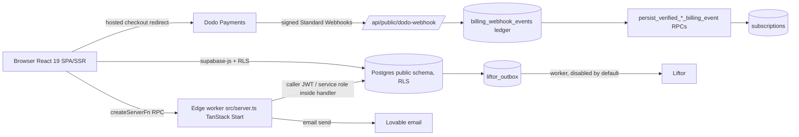
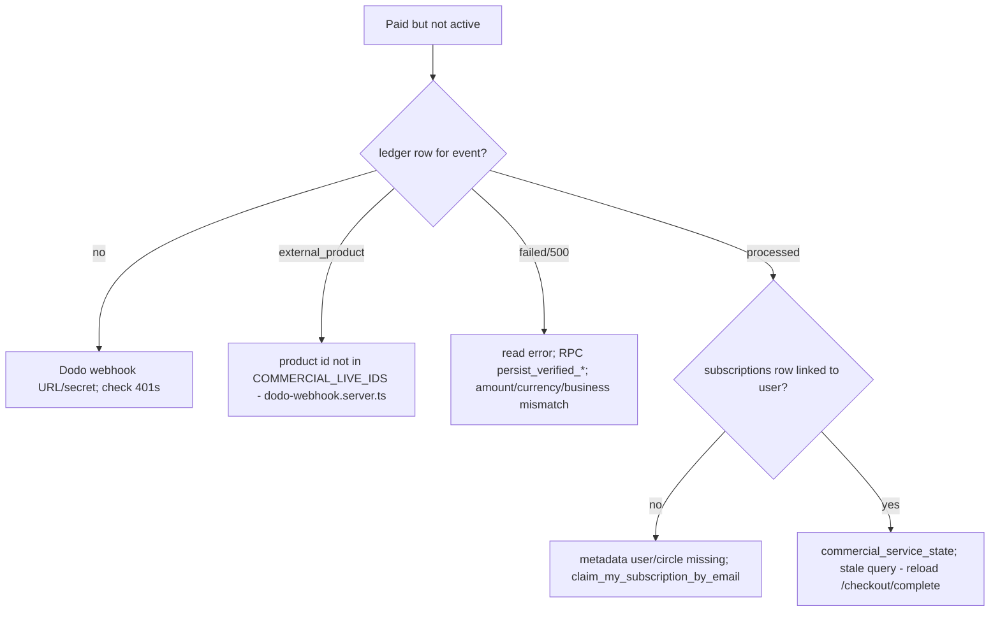

<!-- Copied read-only from the Kindness Habits project (commit 004630bd) on 17 Nov 2026. Re-copy to refresh. -->

=============== founder/FOUNDER_OPERATING_MANUAL_2026-11-17.md ===============
# Kindnesss — Founder Operating Manual

*Updated 17 November 2026. For the site owner. Plain language, no coding needed.*

## 1. Your daily check (5 minutes)
1. Check your inbox (mandyking308@gmail.com) for **"New Contact us message on Kindnesss"** or **"New privacy request on Kindnesss"**. Check spam the first time.
2. Sign in at **joinkindnesss.com/admin** (two-step sign-in required).
3. Open **Enquiries** — reply to each new message from your own email, then set its status (new → contacted → qualified → closed).
4. Open **Privacy requests** — these have legal deadlines. Verify the person's identity before acting, then fulfil and record it.
5. Open **Customers / Subscriptions** — look for new paying customers or anything marked as a problem.

## 2. How a customer buys
1. They choose a plan on **/pricing** (all prices are in US dollars).
2. They pay on the Dodo Payments page.
3. They come back to **/checkout/complete**, which waits until Dodo confirms payment.
4. Access switches on only after Dodo's signed confirmation reaches us. A return link alone never grants access.
5. Head Office buyers then fill in **"Finish setting up your Head Office"** (name and country) and press **Create my Head Office**.

## 3. Refunds and cancellations
- Do these in your **Dodo Payments** dashboard. Kindnesss updates itself when Dodo sends the cancellation or refund. Access then switches off.
- Never grant access by hand to someone who has not paid.

## 4. Your owner test pass
- Your own account has a free owner test pass so you can see every dashboard without paying. It is never sold and only unlocks your own Circles. Ask the developer to remove it when you no longer want it.

## 5. What customers see
- **Families & Individuals:** Family Circle, child profiles (first names only), pledges, approvals, Kindness Passport.
- **Schools:** School Console — staff, years & forms, candidates, campaigns, impact, billing.
- **Organisations:** Organisation Console with a setup checklist, invites, act recording and approvals.
- **Head Office (Company / School Group):** combined totals only. Groups smaller than five are hidden for privacy.
- **Help:** the Help button on every page opens the Help Centre (**/help**), which has 68 guides sorted by audience and task.
- **Contact us (/contact):** short form for personal or organisation enquiries, plus a **Privacy & data** tab.
- **Languages:** 103 languages via GTranslate, only after the visitor agrees in the cookie choices. Never used on checkout pages.

## 6. Rules you must keep
- Kindness Credits have no cash value. Kindnesss never holds pledge or reward money.
- No messages between strangers and children. No public child profiles or leaderboards.
- No free plans or trials. Unpaid means access is paused.
- Don't claim SOC 2, ISO or other certifications we don't hold.
- Legal pages are versioned. Changing their wording creates a new version that customers must accept again, so ask before editing.

## 7. If something goes wrong
| Problem | What to do |
|---|---|
| A customer paid but has no access | Check Dodo for the payment, then **Customers / Subscriptions** in admin. Ask the developer to check the payment confirmation records. |
| No alert emails arriving | Check spam, then check **Enquiries** directly. Ask the developer to check the email logs. |
| The site looks broken | Note the page address and take a screenshot. Ask the developer. |
| Someone asks for their data to be deleted | Use **Privacy requests**. Verify their identity first. |

## 8. Company details (footer)
Global Solutions Management LLC · Delaware State File No. 10420698. The footer has a **Contact us** button instead of an email address. A postal address can be added once you give the exact one.

## 9. Where your manuals are
Every manual (yours, the technical manuals and the customer guides) can be downloaded from **admin → Manuals**.

=============== guides/individual-family-manual.md ===============
# Individual and Family manual (internal)
## Individual adult
1. Open `/auth`, use your own account, verify as prompted and review current terms.
2. Choose an Individual plan on `/pricing`; the account and personal Passport are set up as part of that purchase (no free plan). Adult self-directed kindness needs no organisation affiliation. New missions and completed acts need an active paid plan; existing records stay viewable while access is paused.
3. Use your private personal missions/reflections. Acts are self-recorded, not independently verified. Individual Plus uses `/pricing?segment=individual`; paid benefits require the signed provider event.
## Guardian and Family
1. Choose Family in onboarding; use first names/nicknames only. Guardian owns profiles and privacy.
2. Invite trusted adults through `/settings`; membership is invitation/approval based. Members may pledge but cannot change child safety settings.
3. Create `/pledges/new`, choose optional non-cash/no reward or private adult reward; child completes and reflects; guardian uses `/review` to approve/request detail. Approval awards credits exactly once.
4. Under-13s do not log in. Ages 13–17 need the separate guardian-verification direct-access gate. Never substitute an adult login.
5. School continuity uses guardian-controlled stable identity and one-use 72-hour school links. Recent sign-in, verified guardian email, terms/disclosure and authorised school redemption remain required. Receiving school sees its own records only.
## Recovery
Retry interrupted setup in the same account/tab to reuse setup state; never create a duplicate Circle to repair a feed failure. For expired invites, guardian reissues; never paste tokens into support. Text reflections suffice where photo controls are unavailable; photo evidence is optional/guardian-controlled. Data access/export/correction/delete is a request through `/privacy-request`, not automatic deletion. Credits are non-monetary, non-transferable and never cash; rewards are privately fulfilled off-platform.

## Verification and release boundary
Reviewed against saved source on 10 November 2026, not a blanket live certification. Prior final-release evidence confirms public pages, exact 51 pricing links and selected secure-form translation; it does not certify every populated signed-in task or a real hosted paid purchase. Ordinary Organisation HQ dependencies were applied as drizzle 0040/0041 in the release report; do not reapply historical g/j or classification/identifier migrations. Fresh live readback remains the release coordinator’s responsibility. Sponsored foundation is unapplied and live sponsorship is hard-disabled. Dependency advisories and incomplete protected/paid translation checks remain release blockers. Gary’s counsel documents are separate and unchanged.

## Support and evidence hygiene
Published contact email: contact@global-solutions-management.com. Inbox monitoring, delivery, automatic ticket alerts and response times are not independently verified. `/contact` is the existing enquiry queue, not a guaranteed personal-data support channel. Personal-data requests use `/privacy-request`. Never collect passwords, session data, card details, secure links, child identities, rosters, reflections or case files in public Help or ordinary email. Record a non-sensitive route, role, language, timestamp, source SHA and PASS/FAIL/NOT RUN, not private records.

=============== guides/organisation-hq-manual.md ===============
# Organisation, Charity and HQ manual (internal)
## Ordinary Organisation registration
1. Use `/pricing?segment=organisations` and `/organisation-signup` for the existing shared journey; no duplicate charity purchase path.
2. Choose true Company/Business, Charity/NGO/Nonprofit, Foundation/Trust, Public Sector/Institution or Other type. Legal name, country and applicable optional company/charity/foundation/institution/local identifiers are validated server-side. Care declaration is separate.
3. Confirm adult authority and organisation terms. On auth return plan/capacity/cadence/scope are hints; confirmations must be ticked again.
4. Choose an owned organisation or create eligible pending setup. Existing 21 Organisation products are 7 capacities × 3 cadences; prices come only from canonical `/pricing`. USD, selected term upfront. Do not fabricate prices/IDs.
5. Existing Dodo checkout and signed mapped webhook bind service state to the actual recipient sector/tenant. Browser return never grants access. Pending capacity is zero; do not buy twice.
## Staff operations
Authorised roles coordinate voluntary staff/community missions and eligible volunteering. New/imported roster rows default invited; explicit consent activates participation. Private identities/reflections are not ordinary roster DTOs. Ordinary funded eligibility supports sectors independently of company-only reviewed corporate enterprise gates. Care/public-service staff access never grants resident/patient/justice programme privileges.
## Organisation HQ
Existing 21 hq_company aliases cover ordinary sectors while retaining immutable actual sector. Select HQ scope before purchase; no new SKU. HQ links stay same-sector and authorised; school_group is separate. One pooled opted-in participant cap spans sites, counts each person once and releases on opt-out; sites are not separate charges. Local staff permissions remain independent; HQ reports are aggregates only. Owner-initiated same-sector upgrades require quote/confirmation and verified provider change, not auto-charge or duplicate purchase.
## Recovery
Check intended account, owned circle, actual type, site/HQ scope, acceptance, live funded evidence and role. Missing tables/functions/readiness is a release blocker, not a client permission issue. Applied 0040/0041 are recorded in final-release evidence; fresh production checks required before certifying any specific customer. Never mutate sector to company to make checkout work.

## Verification and release boundary
Reviewed against saved source on 10 November 2026, not a blanket live certification. Prior final-release evidence confirms public pages, exact 51 pricing links and selected secure-form translation; it does not certify every populated signed-in task or a real hosted paid purchase. Ordinary Organisation HQ dependencies were applied as drizzle 0040/0041 in the release report; do not reapply historical g/j or classification/identifier migrations. Fresh live readback remains the release coordinator’s responsibility. Sponsored foundation is unapplied and live sponsorship is hard-disabled. Dependency advisories and incomplete protected/paid translation checks remain release blockers. Gary’s counsel documents are separate and unchanged.

## Support and evidence hygiene
Published contact email: contact@global-solutions-management.com. Inbox monitoring, delivery, automatic ticket alerts and response times are not independently verified. `/contact` is the existing enquiry queue, not a guaranteed personal-data support channel. Personal-data requests use `/privacy-request`. Never collect passwords, session data, card details, secure links, child identities, rosters, reflections or case files in public Help or ordinary email. Record a non-sensitive route, role, language, timestamp, source SHA and PASS/FAIL/NOT RUN, not private records.

## Lawful basis (10 Nov 2026)
Employee opt-in permits participation; it is not the employer's lawful basis. The employer documents its own basis, keeps use to the kindness programme and never uses Kindnesss data for monitoring, ranking or performance. HQ sees aggregates only (groups under five hidden).

=============== guides/school-group-manual.md ===============
# School and School Group manual (internal)
## Single school
1. Authorised adult selects Education at `/pricing?segment=education`, authenticates and completes school organisation acceptance/setup at `/school/setup`.
2. Confirm active signed subscription and owned-school binding before expecting paid Console tools at `/organisation`. Pending purchases have zero participating capacity.
3. Invite owner/admin/teacher/reporting roles deliberately. Teacher tiers and live class/year/school grants are school-only; absence of a live grant fails closed to aggregates. Headteacher designation is not a new universal role.
4. Configure years/classes; subgroup membership must share primary class. Remove incompatible subgroup assignments explicitly before changing class; no silent historical cleanup.
5. Review OneRoster CSV before explicit insert-only import. This is not live SIS sync. Imported pupils default invited, not opted-in; guardian requirements remain.
6. Run scoped challenges and authorised approval. Reports/export PDF/CSV use suppressed server-authorised aggregates; never recompute withheld values.
## School Group HQ
1. Choose School Group HQ scope in `/organisation-signup`; existing 24 Education products map to 24 school_group HQ aliases. No Organisation SKU grants School Group rights.
2. Wait for verified provider evidence; `/hq` return is prefill only. Complete authorised setup if eligible; unavailable/pending is not success.
3. Add country/region/school structure through available audited controls; only owned/administered eligible schools may link. Cross-customer overlaps create nothing.
4. One group pooled active opted-in participant cap counts each guardian-approved identity once. Invitations do not count; opt-out frees capacity; no paid school-count limit.
5. Group reports are aggregate-only, never pupil/class/School Console access. A linked school below five active participants, including zero, withholds group totals.
## Recovery
Used/expired staff invitations need a fresh authorised invite. Missing school tools require live teacher grant and school/funded scope checks, not UI widening. A school move uses guardian-approved one-time Passport claim, never name matching or Family history sharing. Mock disposable payment/tenant checks exist; first funded group dashboard and real hosted payment are not comprehensively live-certified.

## Verification and release boundary
Reviewed against saved source on 10 November 2026, not a blanket live certification. Prior final-release evidence confirms public pages, exact 51 pricing links and selected secure-form translation; it does not certify every populated signed-in task or a real hosted paid purchase. Ordinary Organisation HQ dependencies were applied as drizzle 0040/0041 in the release report; do not reapply historical g/j or classification/identifier migrations. Fresh live readback remains the release coordinator’s responsibility. Sponsored foundation is unapplied and live sponsorship is hard-disabled. Dependency advisories and incomplete protected/paid translation checks remain release blockers. Gary’s counsel documents are separate and unchanged.

## Support and evidence hygiene
Published contact email: contact@global-solutions-management.com. Inbox monitoring, delivery, automatic ticket alerts and response times are not independently verified. `/contact` is the existing enquiry queue, not a guaranteed personal-data support channel. Personal-data requests use `/privacy-request`. Never collect passwords, session data, card details, secure links, child identities, rosters, reflections or case files in public Help or ordinary email. Record a non-sensitive route, role, language, timestamp, source SHA and PASS/FAIL/NOT RUN, not private records.

## Data protection reconciliation (10 Nov 2026)
Institutional customers need a separately signed Data Processing Agreement before children's or employee data is recorded (pathway: `docs/legal/dpa-execution-pathway-2026-11-10.md`; enforcement off, counsel pending). Deletion of records linked to a Passport or school is a verified privacy request, not instant. Translation languages are not legal jurisdictions.

=============== guides/sponsor-preview-manual.md ===============
# Sponsored Access — PREVIEW ONLY manual (internal)
## Absolute release gate
Named existing SaaS subscriptions only; not donations, crowdfunding, arbitrary contributions, gift cards, pooled/partial payment or tax deductions. Written Dodo approval has NOT been received. Payments/renewals are disabled by default and hard-disabled while integration is unreleased even if a flag is set. Candidate `supabase/pending/20261110d_sponsored_access_foundation.sql` remains unapplied.
## What customers can do today
Explore `/sponsor?direction=request` or gift direction, choose an existing plan and read the proposed arrangement. `/partners` explains software sponsorship separately from consultative partnerships and the 20% Impact Promise. They cannot send live sponsor invitations, expect emails, complete a sponsored checkout or activate access. Ordinary eligible self-payment stays unchanged.
## Proposed lifecycle (not a working customer procedure)
Authenticated authorised recipient voluntarily accepts terms/safeguarding and a digest-only one-use expiring invite. Payer-recipient-plan bindings stay immutable; recurring payer obligation requires explicit opt-in. Signed verified metadata alone may activate after full integration. Payer sees consented public organisation name and billing minimum only; no passports, rosters, reflections or reports. Paying grants no guardian/admin/operator role. Renewal/cancel/reissue/decline/take-over controls and mail triggers need completed testing and release.
## Support answer
Say preview/not live plainly. Never promise an invite, charge, tax benefit or automatic billing takeover; never share accounts or purchase into a wrong tenant. Provider approval, lifecycle integration, dependent SQL/security checks and mail delivery verification are external/release dependencies.

## Verification and release boundary
Reviewed against saved source on 10 November 2026, not a blanket live certification. Prior final-release evidence confirms public pages, exact 51 pricing links and selected secure-form translation; it does not certify every populated signed-in task or a real hosted paid purchase. Ordinary Organisation HQ dependencies were applied as drizzle 0040/0041 in the release report; do not reapply historical g/j or classification/identifier migrations. Fresh live readback remains the release coordinator’s responsibility. Sponsored foundation is unapplied and live sponsorship is hard-disabled. Dependency advisories and incomplete protected/paid translation checks remain release blockers. Gary’s counsel documents are separate and unchanged.

## Support and evidence hygiene
Published contact email: contact@global-solutions-management.com. Inbox monitoring, delivery, automatic ticket alerts and response times are not independently verified. `/contact` is the existing enquiry queue, not a guaranteed personal-data support channel. Personal-data requests use `/privacy-request`. Never collect passwords, session data, card details, secure links, child identities, rosters, reflections or case files in public Help or ordinary email. Record a non-sensitive route, role, language, timestamp, source SHA and PASS/FAIL/NOT RUN, not private records.

## Data protection reconciliation (10 Nov 2026)
Institutional customers need a separately signed Data Processing Agreement before children's or employee data is recorded (pathway: `docs/legal/dpa-execution-pathway-2026-11-10.md`; enforcement off, counsel pending). Deletion of records linked to a Passport or school is a verified privacy request, not instant. Translation languages are not legal jurisdictions.

=============== guides/volunteering-manual.md ===============
# Volunteering manual (internal)
## Prerequisites
Adult invited participant with explicit active consent at a funded eligible ordinary Organisation site; organiser operations require the site’s authorised admin role. `/volunteer` requires sign-in/acceptance. Empty no-enrolment state is not a full booking test.
## Organiser
1. Create opportunity and sessions in the available organisation management controls. Review timing, capacity, safety and publication scope.
2. Publish only appropriate voluntary sessions; never enrol someone by import alone.
3. Manage session attendance using protected organiser codes and authorised check-in controls. Codes are not public records.
4. Approve submitted time as an authorised other administrator; self-approval is denied. Hours are non-monetary, not employee scoring.
## Participant
1. Open `/volunteer`, choose your invited organisation and available session. Book or join waitlist; waitlisted is not confirmed.
2. Download calendar/ICS if offered. Calendar download does not reserve capacity; recheck session status.
3. Cancel your own booking when needed. Enter the organiser code only in the working form; fixed-label translations must not change typed code.
4. Submit your own time through available controls and check pending/approved/not approved. Ask organiser about discrepancies. Feedback and peer bookings stay private.
## Recovery/privacy
No organisation: check invitation, active consent, role and funded site. Invalid code: confirm correct session and request organiser help, no guessing or bypass. Pending time: check responsible other admin, not self-approve. Site aggregates suppress under five; HQ volunteering figures require every live scoped site to meet threshold. Never infer hidden figures by subtraction. Populated live booking/check-in and real time approval remain NOT RUN in the prior final release.

## Verification and release boundary
Reviewed against saved source on 10 November 2026, not a blanket live certification. Prior final-release evidence confirms public pages, exact 51 pricing links and selected secure-form translation; it does not certify every populated signed-in task or a real hosted paid purchase. Ordinary Organisation HQ dependencies were applied as drizzle 0040/0041 in the release report; do not reapply historical g/j or classification/identifier migrations. Fresh live readback remains the release coordinator’s responsibility. Sponsored foundation is unapplied and live sponsorship is hard-disabled. Dependency advisories and incomplete protected/paid translation checks remain release blockers. Gary’s counsel documents are separate and unchanged.

## Support and evidence hygiene
Published contact email: contact@global-solutions-management.com. Inbox monitoring, delivery, automatic ticket alerts and response times are not independently verified. `/contact` is the existing enquiry queue, not a guaranteed personal-data support channel. Personal-data requests use `/privacy-request`. Never collect passwords, session data, card details, secure links, child identities, rosters, reflections or case files in public Help or ordinary email. Record a non-sensitive route, role, language, timestamp, source SHA and PASS/FAIL/NOT RUN, not private records.

## Lawful basis (10 Nov 2026)
Employee opt-in permits participation; it is not the employer's lawful basis. The employer documents its own basis, keeps use to the kindness programme and never uses Kindnesss data for monitoring, ranking or performance. HQ sees aggregates only (groups under five hidden).

=============== guides/customer-setup-and-recovery.md ===============
# Customer setup and recovery (internal, 10 November 2026)
## Start with scope, account and consent
Individual: `/auth` → personal `/onboarding` → private Passport; adult 18+. Paid Individual Plus from canonical Pricing. Family: guardian account → Family onboarding → `/family`; under-13 no login, teens guardian-verified direct access. School: Education pricing → authorised school setup → Console. Ordinary Organisation: shared registration with actual type/country/applicable identifiers → selected owned site or HQ scope → existing secure checkout.

## Paid setup
Creating an account or returning from checkout never grants paid features. Exact mapped signed payment, immutable account/tenant/sector, verified service state, capacity and authorised roles are all required. Current price/cadence/capacity is on `/pricing`; do not copy legacy product names or amounts.
HQ: one group with pooled active opted-in participants; 45 aliases (21 ordinary Organisation, 24 School Group) use existing products. Signed sector is immutable. Group reporting does not confer local staff or child access. School cohorts under five suppress group totals. See audience manuals for structure/linking.

## Recovery order
1. Confirm intended account and route; request fresh reset at `/auth` if needed. Do not share reset or invite tokens.
2. Retry incomplete setup in same account/tab; separate setup may duplicate records and is a deliberate decision, not default recovery.
3. Payment pending: do not pay again. Confirm scope and non-sensitive reference through authorised support; only verified event reconciles access.
4. Invite expired/used: authorised inviter reissues. Guardian-controlled school link is one-use 72-hour and cannot be replaced with name matching.
5. Missing Console/volunteering: check funded eligibility, active consent and live role/grant. UI is not permission evidence.
6. Data access/correction/export/delete: `/privacy-request`, not Contact or this assistant.
7. Specialist resident/patient/justice services: human safeguarding/consent review, not activation by a staff subscription. Sponsor invitation/payment remains preview-only.

## References
Use Individual/Family, School/School Group, Organisation/HQ, Volunteering and Sponsor manuals plus operator-support-triage for concrete tasks. Prior final-release and working-form translation reports contain narrower actual checks and known gaps; no claim of full hosted signed payment or all first-login flows.

## Verification and release boundary
Reviewed against saved source on 10 November 2026, not a blanket live certification. Prior final-release evidence confirms public pages, exact 51 pricing links and selected secure-form translation; it does not certify every populated signed-in task or a real hosted paid purchase. Ordinary Organisation HQ dependencies were applied as drizzle 0040/0041 in the release report; do not reapply historical g/j or classification/identifier migrations. Fresh live readback remains the release coordinator’s responsibility. Sponsored foundation is unapplied and live sponsorship is hard-disabled. Dependency advisories and incomplete protected/paid translation checks remain release blockers. Gary’s counsel documents are separate and unchanged.

## Support and evidence hygiene
Published contact email: contact@global-solutions-management.com. Inbox monitoring, delivery, automatic ticket alerts and response times are not independently verified. `/contact` is the existing enquiry queue, not a guaranteed personal-data support channel. Personal-data requests use `/privacy-request`. Never collect passwords, session data, card details, secure links, child identities, rosters, reflections or case files in public Help or ordinary email. Record a non-sensitive route, role, language, timestamp, source SHA and PASS/FAIL/NOT RUN, not private records.

## Family guardians
Use the same account and the same browser tab. Do not start a second, separate setup. The app may report it could not confirm whether the Circle was created; a partial (empty) Circle may remain. “Start a separate setup” is a deliberate choice and earlier records are not automatically deleted. Families must **not** send child details through business enquiries.
## School owners / admins
Use `/school/setup` then `/organisation` after verified Education payment and authority.
## Teachers / reporting viewers
Live school tiers and grants restrict access server-side. Group reports and `/hq` remain aggregate-only.
## Companies
Use `/organisation-signup` and the shared Organisation tariff, not a legacy checkout.
## Communities
Read `/community` before adult-only setup; no general child enrolment rights.
## Education groups
Choose School Group scope before purchase and complete eligible authorised HQ setup.
## Other recovery destinations
`/reset-password`, `/accept-terms`, `/settings`, `/review`, `/volunteer`, `/safety`, `/children-privacy`, `/billing-refunds`, `/kindness-passport`, `/pathways`, `/sponsor`, `/help` are existing task/help destinations.

## Data protection reconciliation (10 Nov 2026)
Institutional customers need a separately signed Data Processing Agreement before children's or employee data is recorded (pathway: `docs/legal/dpa-execution-pathway-2026-11-10.md`; enforcement off, counsel pending). Deletion of records linked to a Passport or school is a verified privacy request, not instant. Translation languages are not legal jurisdictions.

=============== technical/KINDNESSS_MASTER_TECHNICAL_MANUAL_2026-11-13.md ===============
# Kindnesss Master Technical Manual — 2026-11-13

> **PRIVATE / INTERNAL.** Never place under `public/`, a route, or a published URL. Contains no secrets, tokens, PII or customer identifiers — keep it that way.
>
> - Source commit at authoring: `550f40dc` (repository HEAD moves with each saved change; re-run the generator to refresh appendices).
> - Method: hand-written from source reading + the 13 Nov audit reports; appendices generated by `bun scripts/generate-technical-appendices.ts` (git-tracked files + migration SQL only, no DB writes, no network). Live counts came from read-only `information_schema`/`pg_proc` queries.
> - Labels: **PROD** = joinkindnesss.com live; **TEST** = throwaway Postgres / bun tests; **READ-ONLY** = aggregate queries only.
> - Coverage honesty: vendor dashboards (Dodo, email provider, Liftor, hosting) were **not** inspected; their settings are UNVERIFIED unless stated.

Companion documents: [Source file index](KINDNESSS_SOURCE_FILE_INDEX_2026-11-13.md) · [Database & RPC dictionary](KINDNESSS_DATABASE_AND_RPC_DICTIONARY_2026-11-13.md) · [Test & incident playbook](KINDNESSS_TEST_AND_INCIDENT_PLAYBOOK_2026-11-13.md) · [Configuration register](KINDNESSS_CONFIGURATION_REGISTER_2026-11-13.md). Earlier chapter docs `01-…` to `11-…` in this folder remain the detailed per-topic references.

## Contents
1. Executive summary
2. Build, version, URLs, identifiers
3. Design freeze and limited scope
4. Architecture
5. Dependencies and runtime
6. File/folder map
7. Public routes
8. Private / authenticated routes
9. Redirects and canonical behaviour
10. Persona journeys
11. Auth, email verification, Terms, safeNext
12. Checkout, SKUs and price sources
13. Dodo webhook journey, ledger and entitlement
14. 13 Nov incident fixes and adversarial tests
15. Dodo environment (no secrets)
16. Cancellation, refund, dispute, retry
17. Data model
18. External connections
19. Storage
20. Trust, safety, privacy, cookies, translation
21. Safeguarding roles and RLS
22. Security headers, CORS, rate limits
23. Backup, restore, incident roles
24. Diagnostics and monitoring
25. Accessibility and responsive checks
26. Metadata, sitemap, robots, international
27. Tests
28. Deployment and rollback
29. Release flags and hidden features
30. Issue register and launch gates
31. Troubleshooting decision trees
32. Glossary
33. Updating this manual / change log

## 1. Executive summary
Kindnesss is a universal, person-centred Kindness Passport. Implemented today: Family/child (guardian-controlled), Individual Passport, Schools and School Group HQ, Organisations/Company sites, Company HQ, company volunteering, sponsored access (payments gated). Pathways is **retired** as a customer product (history kept; `create_pathway_organisation` EXECUTE revoked from authenticated). Sales are fixed self-service: published plan → electronic terms (+DPA where required) → Dodo checkout → access granted **only** by a signed, verified Dodo webhook. Kindness Credits have no monetary value; Kindnesss never handles pledge/reward money.

Current honest status (PROD): payment chain verified in TEST for all 51 SKUs (73/73 matrix); **hosted Dodo purchase → dashboard NOT verified** (no isolated sandbox); real confirmation-email click NOT verified.

## 2. Build, version, URLs, identifiers
| Item | Value |
|---|---|
| Lovable project | 1a7ca600-3496-406b-8c3d-9f7d962edcef |
| Primary URL | https://joinkindnesss.com (also www.) |
| Lovable URL | https://kindnesss.lovable.app |
| Backend | Lovable Cloud (one instance serves preview and live) |
| Source commit | `550f40dc` |
| Release records | `docs/verification/*.md`, `docs/technical/10-release-and-legal-register.md` |

## 3. Design freeze and limited scope
Public brand, homepage order, approved copy, prices and legal texts are frozen (see `mem://` owner rules, `docs/verification/home-*.md`). Changes are bug-fix only, minimal, tested, then published and live-verified. Adult care, justice and sponsor modules are strategic, not live.

## 4. Architecture


## 5. Dependencies and runtime
TanStack Start v1 + TanStack Router (file routes in `src/routes`, generated `src/routeTree.gen.ts`), React 19, Vite 8, Tailwind v4 (exact versions: chapter 01 table, checked by `scripts/doc-drift.ts`) (`src/styles.css` tokens), shadcn UI (`src/components/ui`), supabase-js, Bun for scripts/tests. Server code runs on workerd (Cloudflare-style): no Node-only APIs. Entry: `src/server.ts` (security headers, SSR error normaliser), `src/start.ts` (middleware), `src/router.tsx`.

## 6. File/folder map
Counts (generated, checked in CI):

<!-- inventory:start (generated by scripts/doc-drift.ts --write) -->
| Area | Files |
|---|---|
| `src/routes/` files | 91 |
| `src/lib/` files | 225 |
| `src/components/kindnesss/` files | 94 |
| `drizzle/migrations/*.sql` | 47 |
| `supabase/migrations/*.sql` | 61 |
| `supabase/pending/*.sql` (unapplied/owner-applied) | 24 |
| `tests/` files | 375 |
| `docs/` files | 234 |
| All tracked files | 1309 |
<!-- inventory:end -->

| Path | Contents |
|---|---|
| `src/routes/` | Route files (pages, `api/public/*`, `lovable/email/*`) |
| `src/lib/` | Domain logic, server functions (`*.functions.ts`, `*.server.ts`), policies |
| `src/components/kindnesss/` | Brand components |
| `drizzle/` | Applied migration files |
| `supabase/migrations/` · `supabase/pending/` | SQL (pending = owner-applied, never reapply) |
| `tests/` | Bun unit, `tests/rls` SQL/sh harnesses, `tests/integration`) |
| `docs/` | Documentation |
Full per-file listing: [Source file index](KINDNESSS_SOURCE_FILE_INDEX_2026-11-13.md).

## 7. Public routes
Marketing: `/`, `/who-its-for`, `/how-it-works`, `/circles`, `/families`, `/schools`, `/school-groups`, `/organisations`, `/companies`, `/charities`, `/care`, `/community`, `/public-services`, `/partners`, `/impact`, `/organisation-hq`, `/organisation-evidence-guide`, `/kindness-ideas`, `/kindness-passport`, `/pricing`, `/demo`, `/help`, `/contact`, `/sponsor`.
Legal (13 approved pages): `/terms`, `/terms-of-business`, `/privacy`, `/children-privacy`, `/cookies`, `/safety`, `/acceptable-use`, `/accessibility`, `/data-processing`, `/institutional-dpa`, `/billing-refunds`, `/security-assurance`, `/legal` (+ `/legal-review`).
Forms: `/privacy-request`, `/contact`, `/organisation-signup`. Catch-all 404: `src/routes/$.tsx`.
Token pages (noindex, no translation): `/invite/$code`, `/k/$token`, `/passport-link/$token`, `/kinder/$slug`, `/verify-guardian/$childId`, `/sponsor/accept` (intentionally closed).

## 8. Private / authenticated routes
Legacy guarded pages (own guards): `/family`, `/settings`, `/onboarding`, `/review`, `/complete`, `/pledges/new`, `/pledges/$id/edit`, `/organisation`, `/school/setup`, `/company/setup`, `/community/setup`, `/admin`, `/admin/ideas`, `/accept-terms`, checkout pages `/checkout/*`. New pages use pathless `src/routes/_authenticated.tsx` (client-only gate): `/hq`, `/hq/accept`, `/company-groups`, `/volunteer`, `/sponsorships`. Retired: `/pathways*`, `/admin/pathways` (redirect / fail-closed).
Server endpoints: `/api/public/dodo-webhook` (signature-verified), `/api/public/liftor-outbox` (worker token), `/lovable/email/*` (managed email).

## 9. Redirects and canonical behaviour
Canonical host joinkindnesss.com; per-route `head()` sets title/description/og. Retired Pathways entry points → `/pricing?segment=organisations` or `/contact`. Sign-in return uses `src/lib/safe-next.ts`: allowlisted prefixes (`/family`, `/checkout`, `/invite`, `/verify-guardian`, `/passport-link`, …) and exact paths (`/hq`, `/hq/accept`, `/company-groups`, `/volunteer`, `/school-groups`, `/organisation-signup`); absolute, protocol-relative and backslash paths are discarded → default `/family`.

## 10. Persona journeys
```mermaid
flowchart TD
  V[Visitor] --> P[/pricing/] --> A[/auth sign-up + 18+ clickwrap/] --> T[/accept-terms/] --> C[Dodo checkout] --> WH[signed webhook] --> CC[/checkout/complete polling/]
  CC --> FAM[Family: /family dashboard -> child profile -> pledge -> Kinder completion -> guardian /review approve -> credits]
  CC --> IND[Individual: personal Passport /family]
  CC --> SCH[School: /school/setup -> organisation console, teacher tiers, headteacher]
  CC --> ORG[Organisation/Company site: /organisation, volunteering /volunteer]
  CC --> HQ[HQ admin: /hq -> invites country/region/report viewer]
  HQI[HQ invitee email link /hq/accept?token] --> A2[/auth?next=/hq/accept...] --> T2[Terms gate] --> ACC[customer_hq_accept_invite] --> DEST{role}
  DEST -->|owner/admin| H1[/hq] 
  DEST -->|scoped| H2[/company-groups]
  G[Guardian link /verify-guardian/id] --> A3[/auth next] --> T3[Terms] --> VG[verification page]
  FM[Trusted family adult /invite/code] --> A4[/auth next] --> AI[accept_invitation]
```
Kinder (child) uses `/kinder/$slug` + PIN (`create_kinder_access`), never email; no messaging, no public profile. Care/charity staff use the Organisation path (no separate care module live).

## 11. Auth, email verification, Terms, safeNext
`src/routes/auth.tsx` (sign-in/up, Google + Lovable providers), `src/routes/reset-password.tsx`, signUp `emailRedirectTo` carries `next`; `/accept-terms` forwards `next` when signed out; `useAcceptanceGate` enforces current Terms/Privacy versions (`current_terms_version()` etc.) on token pages. `EMAIL_LINK_FALLBACK_ENABLED=false`. Real email click-through: NOT VERIFIED.

## 12. Checkout, SKUs and price sources
- 51 canonical paid SKUs, USD only. Single source: `src/lib/marketing-pricing*` + `src/lib/family-usd-billing.ts`; `src/lib/dodo-commercial-catalogue.ts` derives amounts; product→plan map `src/lib/dodo-products.ts`; `COMMERCIAL_LIVE_IDS`/`isLedgerKnownProduct` in `src/lib/dodo-webhook.server.ts`.
- Family: $17.99 / $47.99 / $169.99 (three cadences).
- 45 HQ aliases (21 organisation → Company HQ, 24 education → School Group HQ), pooled participants: `src/lib/hq-plan-catalogue.ts`, mirrored in service-only `hq_plan_eligibility`.
- Checkout server fns: `src/lib/checkout.server.ts`, `education-checkout.server.ts`, `commercial-checkout.functions.ts`, `premium-checkout.server.ts`. Checkout requires owned circle (school/company) or adult personal Passport (Individual Plus) and verifies webhook connectivity before creating a session.

## 13. Dodo webhook journey
`src/routes/api/public/dodo-webhook.ts`: verify Standard Webhooks signature (`webhook-id/timestamp/signature`) → reject 401 → insert ledger row `billing_webhook_events` (unique event id = idempotency; full payload for ledger-known products, redacted for foreign) → route by product: Family → `persist_verified_family_billing_event`, Education → `persist_verified_education_billing_event`, commercial → `persist_verified_commercial_billing_event`, HQ (metadata `kindnesss_kind=hq`) → `persist_verified_hq_billing_event` → ledger `processed`. Business id, currency USD and exact amount must match. Reads: `getMySubscription`, `getMySchoolPlanSubscription`, `getMyCommercialServices` → `commercial_service_state` / `commercial_subscription_evidence`. `/checkout/complete` polls until `isVerifiedActivation`.

## 14. 13 Nov incident fixes and adversarial tests
- Family proof redacted: legacy `decideWebhook` labelled 51 current ids `foreign_product`; route now ignores that label for ledger-known ids. Tests: `tests/retest-family-webhook-route.test.ts`, `tests/integration/webhook-db.itest.ts`, `tests/rls/run-deep-audit.sh` (73/73).
- HQ invite: destination lost at sign-in, missing Terms gate, scoped roles dead-ended → `src/lib/hq-accept-destination.ts`, `src/routes/_authenticated.hq_.accept.tsx`, `tests/hq-accept-legal-gate.test.ts`.
- Deep audit fixes (guardian/child/passport-link/org console/company setup return + Terms, billing load error, Liftor retry): `tests/deep-audit-2026-11-13.test.ts`.
Reports: `docs/verification/kindnesss-critical-family-hq-incidents-2026-11-13.md`, `kindnesss-family-hq-retest-2026-11-13.md`, `kindnesss-deep-reliability-audit-2026-11-13.md`.

## 15. Dodo environment (no secrets)
Names only: `DODO_PAYMENTS_API_KEY`, `DODO_PAYMENTS_WEBHOOK_KEY`, `DODO_BUSINESS_ID`, test set `DODO_TEST_*` (`DODO_TEST_BACKEND_ISOLATED` absent → sandbox E2E blocked). Live mode owner-confirmed. UNVERIFIED (owner to confirm in Dodo): tax-exclusive prices, Adaptive Currency OFF, customer self-service plan change OFF, webhook endpoint pointing at joinkindnesss.com.

## 16. Cancellation, refund, dispute, retry
Cancelled/expired/refunded → inactive; a later "active" does not revive a cancelled terminal state; replays ignored by event id; out-of-order handled by terminal-state retention. `REFUND_REVOCATION_POLICY_ENABLED=false`. Known gaps: F-P1 `dispute.opened` ledgered as ignored (not needs_reconciliation); F-P2 permanent refusals return HTTP 500 → Dodo retries; F-P3 plan_changed to new product → binding conflict 500.

## 17. Data model
Live (READ-ONLY 13 Nov): 74 public tables, 0 views, 266 functions, 1 storage bucket. Domains: billing (subscriptions, billing_webhook_events, hq_plan_eligibility, hq_plan_change_requests), family/child (families, family_members, children, pledges, completions, acts, badges, kinder_access), school (organisation_*, school_*), HQ/company (company_*, customer HQ via school_groups/company_groups), privacy/legal (legal_acceptances, privacy_requests, *_acknowledgements, access_audit_events), external (liftor_outbox, commercial_enquiries). Full dictionary: [Database & RPC dictionary](KINDNESSS_DATABASE_AND_RPC_DICTIONARY_2026-11-13.md).

## 18. External connections
| Service | Use | Status |
|---|---|---|
| Lovable Cloud | auth, DB, hosting | VERIFIED live |
| Dodo Payments | hosted checkout + signed webhooks | live mode; hosted E2E UNVERIFIED |
| Lovable email | auth/transactional mail (`src/routes/lovable/email`) | click-through UNVERIFIED |
| Liftor | enquiry/privacy hand-off via `liftor_outbox` | worker disabled by default (`LIFTOR_OUTBOUND_ENABLED`) |
| GTranslate | public pages after consent; never checkout/token pages | free, consent-gated |
| Manual support | contact form → team | process owner: Mandy (incident lead) |

## 19. Storage
One bucket live: `database_export_14_10_26` (export artefact, not app media). Child photo upload is optional/disabled-safe; no public child media bucket.

## 20. Trust, safety, privacy, cookies, translation
`/privacy-request` → `privacy_requests` (honeypot shows receipt without storing; per-email rate limit). Cookie consent gates translation; `EXTERNAL_TRANSLATION_ENABLED=false` for instruction translator; never send child/personal/session data to translators. No stranger-to-child messaging, no leaderboards, first names only.

## 21. Safeguarding roles and RLS
Guardian owns child; family members can pledge, not change safety settings. School tiers/headteacher/school-wide grants (`src/lib/school-role-policy.ts`) fail closed to aggregates; group/HQ reporting aggregate-only, cohorts under five suppressed; HQ never grants site or pupil access. Every public table: GRANT + RLS (see `docs/guides/migration-grants.md`).

## 22. Security headers, CORS, rate limits
`src/server.ts` `withSecurityHeaders`: nosniff, Referrer-Policy strict-origin-when-cross-origin, X-Frame-Options SAMEORIGIN, CSP `frame-ancestors 'self'` only (no script-src by design), Permissions-Policy, HSTS 1 year. No broad CORS on API routes. Rate limits: per-email in contact/privacy RPCs (bypassable — known).

## 23. Backup, restore, incident roles
Lovable Cloud backups; PITR/backup plan UNVERIFIED. Synthetic restore drill PASS (`tests/rls/run-restore-simulation.sh`). Incident gates G1–G9 and owner roles: `docs/verification/kindnesss-final-hardening-2026-11-12.md`, `kindnesss-three-final-tests-2026-11-12.md`. Incident lead: Mandy. MFA: in progress.

## 24. Diagnostics and monitoring
Ledger statuses in `billing_webhook_events`; `access_audit_events`, `passport_audit_events`, `company_team_audit`. Server logs via Lovable server-function logs. No third-party APM. See [Playbook](KINDNESSS_TEST_AND_INCIDENT_PLAYBOOK_2026-11-13.md).

## 25. Accessibility and responsive
WCAG contrast fix (scoped darker orange) 12 Nov; `docs/verification/hardening-accessibility-devices-2026-11-12.md`. Widths 390/1440 verified; 320/768 not run in the latest pass. Arabic RTL supported.

## 26. Metadata, sitemap, robots, international
Per-route `head()`; `public/robots.txt`, `public/sitemap.xml`; token/auth pages noindex. USD-only billing; jurisdiction notes `docs/technical/11-global-jurisdiction-applicability-and-legal-operations.md`; `docs/verification/hardening-seo-global-2026-11-12.md`.

## 27. Tests
`bun test tests` (2,167 pass / 1 skip at last audit). SQL harnesses `tests/rls/*.sh` on throwaway Postgres (nss_wrapper, socket under /tmp). Integration `tests/integration/*.itest.ts` (throwaway DB only; skipped by bun test). Commands in the Playbook.

## 28. Deployment and rollback
Save → tests → Publish in Lovable → live readback with cache-busting at 390/1440 → record SHA. Rollback: restore a prior version from Lovable history and republish; DB changes need forward-fix migrations (no destructive rollbacks). Never deploy a failing release.

## 29. Release flags and hidden features
See [Configuration register](KINDNESSS_CONFIGURATION_REGISTER_2026-11-13.md) for every flag with file path.

## 30. Issue register and launch gates
| ID | Issue | State |
|---|---|---|
| G-1 | Hosted Dodo purchase → dashboard | BLOCKED: no isolated sandbox |
| G-2 | Real confirmation-email click | BLOCKED |
| G-3 | Dodo tax/Adaptive Currency/plan-change settings | Owner to confirm |
| F-P1 | `dispute.opened` ledgered `ignored` (not needs_reconciliation) | BLOCKED on owner dispute/refund policy (`REFUND_REVOCATION_POLICY_ENABLED=false`); no wrongful grant |
| F-P2 | Permanent refusals return HTTP 500 → Dodo retries | Kept deliberately: retries are idempotent (ledger event id) and can rescue a missing-account case; no access granted. Revisit with owner |
| F-P3 | `subscription.plan_changed` to a new product → binding conflict 500 | BLOCKED on owner confirming Dodo customer plan changes are disabled; fails closed |
| F-P4 | docs/technical/05 line 22 says v1 not enforced; code enforces | Doc stale |
| A-1 | Browser smoke 320/390/768/1440; fresh security scan | DONE 18:4x–19:12 UTC (see post-hardening report); scan: 1 info (public badges) |
| A-2 | Rate limits per-email; delete no pending guard; /k/ allowlist unreachable | Open, minor (no access impact) |
| A-3 | `claim_my_subscription_by_email` errors ignored → "no subscription" shown instead of "couldn't load" | FIXED 19:1x UTC sweep — `src/lib/billing.functions.ts`, test `tests/claim-error-surfaced.test.ts` |
| A-4 | `/company/setup?plan=<unknown>` crashed | FIXED + live-verified 18:57 UTC — `src/routes/company.setup.tsx`, `tests/company-setup-plan-fallback.test.ts` |
| L-1 | Formal legal/privacy/safeguarding review before public child-facing launch | Required |
| S-1 | Security page sentence about SOC 2 vs memory rule | Owner decision pending |

## 31. Troubleshooting decision trees

Twenty symptom scenarios with safe SQL: [Playbook](KINDNESSS_TEST_AND_INCIDENT_PLAYBOOK_2026-11-13.md).

## 32. Glossary
Circle — a family/school/organisation group. Passport — person's kindness record. Kinder — child view. Ledger — `billing_webhook_events`. HQ alias — HQ plan mapped from an organisation/education SKU. safeNext — sign-in return allowlist. RLS — row-level security. TEST/PROD/READ-ONLY — see header.

## 33. Updating this manual / change log

### How to keep the manual current
1. After any saved code change, note the new commit (`git rev-parse HEAD`).
2. Run `bun scripts/generate-technical-appendices.ts` — rewrites the source index and database dictionary only (no DB connection, no network, binary-safe).
3. Run `bun test tests` — includes `tests/technical-appendices.test.ts` (index validity) and `tests/cross-layer-consistency.test.ts` (no stale claims).
4. Update the chapter the change touches (routes → §7–9, billing → §12–16, schema → §17 + dictionary, flags → configuration register) and the issue register §30.
5. Record evidence in a dated `docs/verification/*.md` report; update the playbook if a new symptom was found.
6. Re-run the path/secret checker (see playbook "Doc integrity check").
7. Never move these docs under `public/` or into a route.

### External settings still needing provider proof
| Setting | Provider | Proof needed |
|---|---|---|
| Hosted purchase → dashboard E2E | Dodo | isolated sandbox (`DODO_TEST_BACKEND_ISOLATED`) |
| Prices tax-exclusive, Adaptive Currency OFF, customer plan changes OFF | Dodo | owner screenshot/confirmation |
| Webhook endpoint + signing key point at joinkindnesss.com | Dodo | owner confirmation |
| Confirmation email delivery and click-through | Lovable email | real test inbox |
| Backup/PITR schedule | Lovable Cloud | provider statement |
| Liftor destination/contract | Liftor | owner decision; worker disabled |
| MFA on owner accounts | all | owner confirmation |
Re-run `bun scripts/generate-technical-appendices.ts`; update chapters touched by a code change (see `docs/technical/AGENTS.md`, `tests/cross-layer-consistency.test.ts`). Change log: 2026-11-13 first master edition after deep reliability audit; 18:57 UTC company-setup fix; 19:1x UTC final sweep (claim-error fix, open-issue statuses).
